# Vauban RDP Session Architecture

**Version:** 1.0  
**Date:** 21 February 2026  
**Author:** Richard Ben Aleya  
**Amended:** 24 July 2026 — Kerberos KDC FD-pass (§11.3.1); crate **0.9.30**  
**Amended:** 14 November 2026 — Kerberos realm table, KDC failover, realm sentinel URL, ambient configuration isolation (§11.3.1)  
**Amended:** 21 November 2026 — Remote Credential Guard, fourth authentication mode (§11.3.1); crate **0.9.61**. The three Kerberos modes are compared in [Vauban RDP Kerberos Authentication Modes](Vauban_RDP_Kerberos_Modes_EN(1.0).md)

---

## Table of Contents

1. [Introduction](#1-introduction)
2. [Architecture Overview](#2-architecture-overview)
3. [RDP Protocol Stack](#3-rdp-protocol-stack)
4. [Session Lifecycle](#4-session-lifecycle)
5. [H.264 Video Streaming](#5-h264-video-streaming)
6. [Input Pipeline](#6-input-pipeline)
7. [Dynamic Resolution](#7-dynamic-resolution)
8. [IPC Protocol](#8-ipc-protocol)
9. [WebSocket Protocol](#9-websocket-protocol)
10. [Frontend Client](#10-frontend-client)
11. [Security Design](#11-security-design)
12. [Testing Strategy](#12-testing-strategy)
13. [Architecture Decisions](#13-architecture-decisions)

---

## 1. Introduction

### 1.1 Background

Vauban provides secure access to both SSH and RDP targets. While SSH sessions stream terminal text over WebSockets, RDP sessions require proxying a graphical desktop -- a fundamentally different challenge involving bitmap rendering, video encoding, and low-latency input forwarding.

### 1.2 Design Goals

| Goal | Approach |
|------|----------|
| Real-time desktop rendering | H.264 video encoding at 60 FPS with WebCodecs decoding |
| Low-latency input | Throttled mouse events (30 Hz), instant keyboard forwarding |
| Dynamic resolution | RDP Display Control channel for fullscreen adaptation |
| Minimal bandwidth | H.264 at 5 Mbps default, configurable per deployment |
| Security | Capsicum sandbox, supervisor-injected configuration, credential isolation |
| Pure Rust | IronRDP (async), OpenH264 (software encoding), no C dependencies in protocol layer |

### 1.3 Scope

This document covers the internal architecture of the RDP session subsystem spanning three crates: `vauban-proxy-rdp` (RDP protocol and encoding), `vauban-web` (WebSocket relay and IPC client), and the frontend Alpine.js component (canvas rendering and input capture). It is a companion to:

- [Privilege Separation Architecture](Vauban_Privsep_Architecture_EN(1.3).md) — overall system design (pipe topology, Capsicum sandboxing, supervisor)
- [IAM Architecture](Vauban_IAM_Architecture_EN(1.1).md) — Casbin RBAC, instance-level access rules, JIT approval workflow
- [AccessGuard Architecture](Vauban_AccessGuard_Architecture_EN(1.0).md) — defense-in-depth RBAC re-check module (`shared::access_guard`) consumed by `vauban-proxy-rdp` on every `RdpSessionOpen` (see §4.1 and §11.5)
- [Runbook: Debugging the IPC Pipe Topology](../runbooks/ipc_topology_debugging.md) — operational triage for `rbac_recheck_timeouts` and `proxy-rdp <-> access` failures

---

## 2. Architecture Overview

### 2.1 Component Diagram

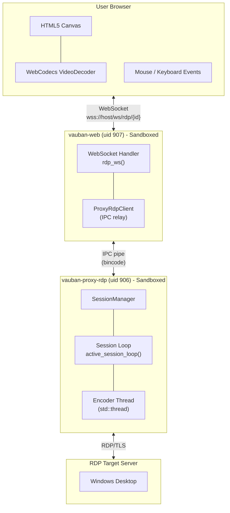

### 2.2 Module Structure

```
vauban-proxy-rdp/
├── Cargo.toml
└── src/
    ├── main.rs              # Entry point, IPC dispatcher, sandbox setup
    ├── session.rs           # RDP connection, active session loop, PNG/H.264 encoding
    ├── session_manager.rs   # Thread-safe session registry
    ├── video_encoder.rs     # H.264 encoding via OpenH264
    ├── ipc.rs               # Async IPC wrapper (AsyncFd)
    └── error.rs             # SessionError, IpcError

vauban-web/src/
├── ipc/proxy_rdp.rs         # ProxyRdpClient (IPC to proxy)
└── handlers/websocket.rs    # rdp_ws() WebSocket handler

vauban-web/static/js/
└── vauban-components.js     # rdpViewer Alpine.js component
```

### 2.3 Dependencies

`vauban-proxy-rdp` uses a focused set of dependencies:

| Crate | Purpose |
|-------|---------|
| `ironrdp` | Pure Rust RDP client (connector, session, graphics, input, display control) |
| `ironrdp-tokio` | Async RDP framing over Tokio |
| `ironrdp-tls` / `tokio-rustls` | TLS for RDP (CredSSP, NLA) |
| `openh264` | H.264 software encoding (Baseline profile) |
| `image` | PNG encoding for fallback bitmap regions |
| `tokio` | Async runtime (multi-thread) |
| `shared` | IPC channel, messages, Capsicum stubs |
| `secrecy` | Zeroize-on-drop for RDP credentials |

---

## 3. RDP Protocol Stack

### 3.1 Connection Sequence

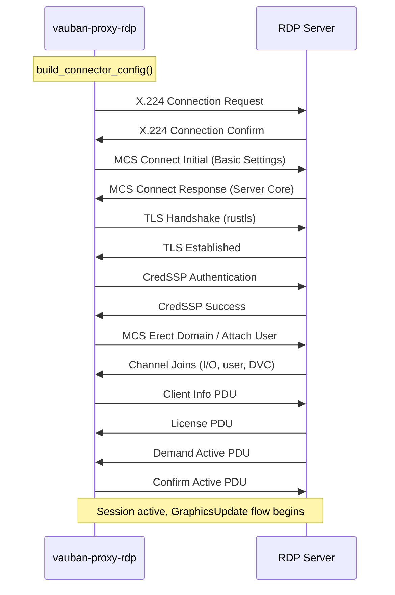

### 3.2 Connector Configuration

The RDP connector is configured for maximum compatibility with Windows servers:

| Parameter | Value | Rationale |
|-----------|-------|-----------|
| Color depth | 32-bit (RGBx) | Best quality; server may downgrade to 16-bit |
| Bitmap compression | Lossy enabled | Reduces bandwidth for bitmap regions |
| Keyboard layout | US (0x0409) | Standard layout; keys mapped by scancode |
| Performance flags | Disable wallpaper, themes, animations; enable font smoothing | Reduces unnecessary graphics updates; text is anti-aliased |
| Dynamic Virtual Channels | DrdynvcClient + DisplayControlClient | Required for runtime resolution changes |
| Pointer rendering | Software (client-side) | More responsive cursor tracking |

### 3.3 Graphics Pipeline

The RDP server sends display updates in two forms, both handled by `active_session_loop`:

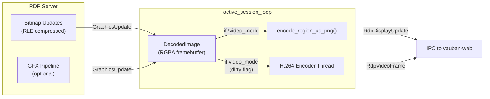

---

## 4. Session Lifecycle

### 4.1 End-to-End Flow

> **Defense-in-depth note.** Since the AccessGuard rollout (April 2026,
> commit `feat(proxy-rdp): wire AccessGuard for defense-in-depth RBAC
> re-check`), `vauban-proxy-rdp` independently re-checks authorization
> against `vauban-access` (via `AccessRequest::CheckAccessByUuid`)
> before opening any upstream RDP session. The re-check runs **inside
> a `tokio::spawn` body**, with a hard 10-second timeout, and is
> implemented in the shared `shared::access_guard` module — the
> identical code path also gates `vauban-proxy-ssh` and every future
> proxy. A verdict from `vauban-web` is necessary but not sufficient
> for the proxy to open the upstream session. Full module
> documentation:
> [Vauban_AccessGuard_Architecture_EN(1.0).md](Vauban_AccessGuard_Architecture_EN(1.0).md).

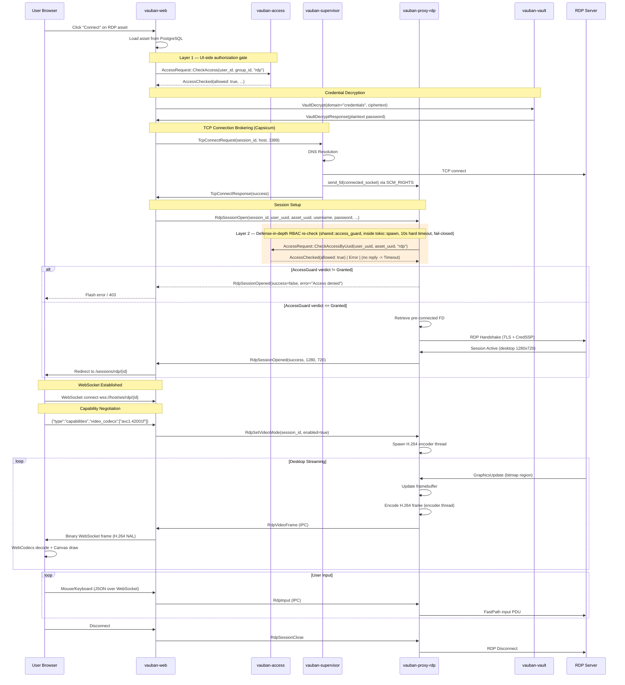

### 4.2 Session Manager

`SessionManager` is the thread-safe registry for active RDP sessions. Each session is identified by a UUID and communicates via a `mpsc::Sender<SessionCommand>` channel.

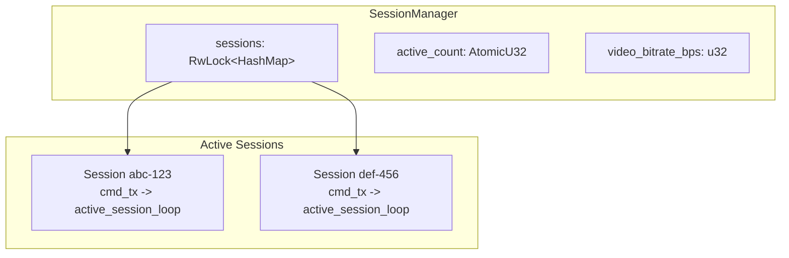

The `video_bitrate_bps` is injected by the supervisor at startup (see [Section 11.2](#112-bitrate-injection)) and used when spawning H.264 encoder threads. The session manager never reads this value from IPC messages.

---

## 5. H.264 Video Streaming

### 5.1 Encoding Architecture

H.264 encoding runs on a **dedicated OS thread** (`std::thread::spawn`), separate from the Tokio async runtime. This prevents encoding latency from blocking RDP protocol processing.

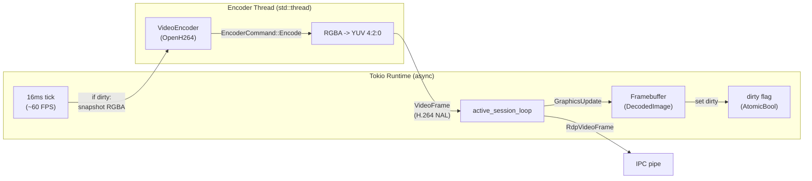

### 5.2 Encoder Configuration

| Parameter | Value | Rationale |
|-----------|-------|-----------|
| Codec | H.264 Baseline (AVC) | Universal browser support via WebCodecs |
| Max frame rate | 60 FPS | Smooth desktop rendering |
| Bitrate | 5 Mbps (default, configurable) | Balance between quality and bandwidth |
| Rate control | Quality mode | Prioritizes visual fidelity |
| Usage type | ScreenContentRealTime | Optimized for text and UI elements |
| Frame skip | Disabled | Every dirty frame is encoded |
| Adaptive quantization | Disabled | Consistent quality across regions |
| Background detection | Disabled | All regions treated equally |

### 5.3 Dimension Alignment

H.264 uses YUV 4:2:0 chroma subsampling, which requires both width and height to be even numbers. The `align_even` function ensures this:

```rust
fn align_even(v: u16) -> u16 {
    (v + 1) & !1
}
```

This is applied at three points:
1. **Encoder initialization**: when the encoder thread starts
2. **Frame encoding**: when processing each `EncoderCommand::Encode`
3. **Reconfiguration**: when the desktop resolution changes

When dimensions are rounded up, the RGBA buffer is **padded with zeros** to fill the extra pixels, preventing out-of-bounds access in the YUV conversion.

### 5.4 Frame Flow

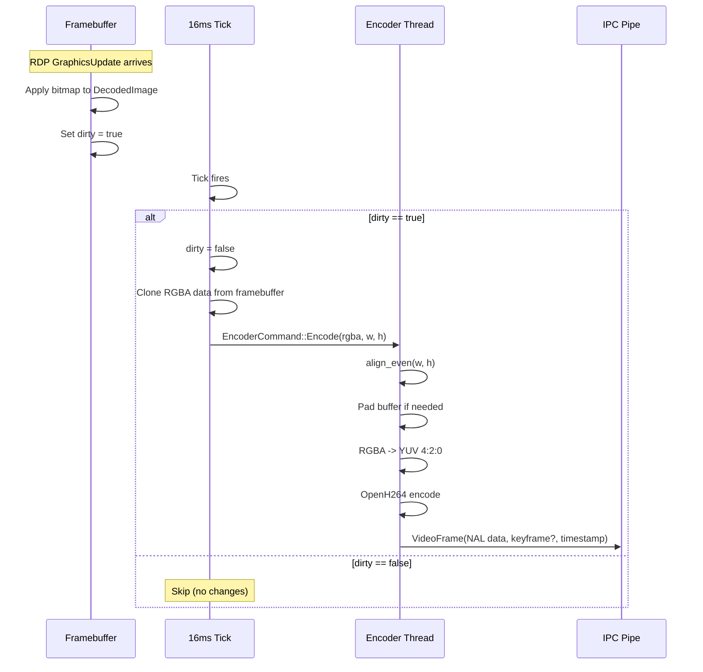

### 5.5 PNG Fallback

Before H.264 is negotiated (or if the browser does not support WebCodecs), individual bitmap regions are encoded as PNG and sent as `RdpDisplayUpdate` messages. This provides a functional baseline for all browsers.

---

## 6. Input Pipeline

### 6.1 Input Events

The browser captures mouse and keyboard events on the HTML5 canvas and sends them as JSON over the WebSocket:

| Event | JSON Format | RDP Translation |
|-------|------------|-----------------|
| Mouse move | `{"type":"mouse_move","x":100,"y":200}` | FastPath mouse move |
| Mouse button | `{"type":"mouse_button","button":0,"pressed":true,"x":50,"y":60}` | FastPath mouse button |
| Mouse wheel | `{"type":"mouse_wheel","delta_x":0,"delta_y":-120}` | FastPath wheel event |
| Key press | `{"type":"key","code":"KeyA","key":"a","pressed":true,"shift":false,...}` | FastPath scancode |

### 6.2 Throttling

Mouse move events are throttled at **33ms intervals** (~30 Hz) on the client side to prevent flooding the WebSocket and IPC channels:

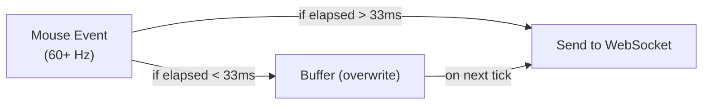

Keyboard events are **never throttled** -- every keypress and release is sent immediately to ensure accurate text input.

### 6.3 Coordinate Scaling

The browser canvas may be displayed at a different size than the RDP desktop resolution. Mouse coordinates are scaled to match the server's resolution:

```javascript
const scaleX = this.desktopWidth / canvas.clientWidth;
const scaleY = this.desktopHeight / canvas.clientHeight;
const x = Math.round(e.offsetX * scaleX);
const y = Math.round(e.offsetY * scaleY);
```

---

## 7. Dynamic Resolution

### 7.1 Display Control Channel

RDP supports runtime resolution changes via the **Display Control Virtual Channel** (`DrdynvcClient` + `DisplayControlClient`). This allows the desktop resolution to adapt when the user enters or exits fullscreen.

### 7.2 Resize Sequence

A critical design decision is that the framebuffer and encoder are **not** resized immediately when the resize request is sent. Instead, they are resized when the server confirms the new resolution via the `DeactivateAll` reactivation sequence. This prevents a race condition where the server continues sending updates at the old resolution.

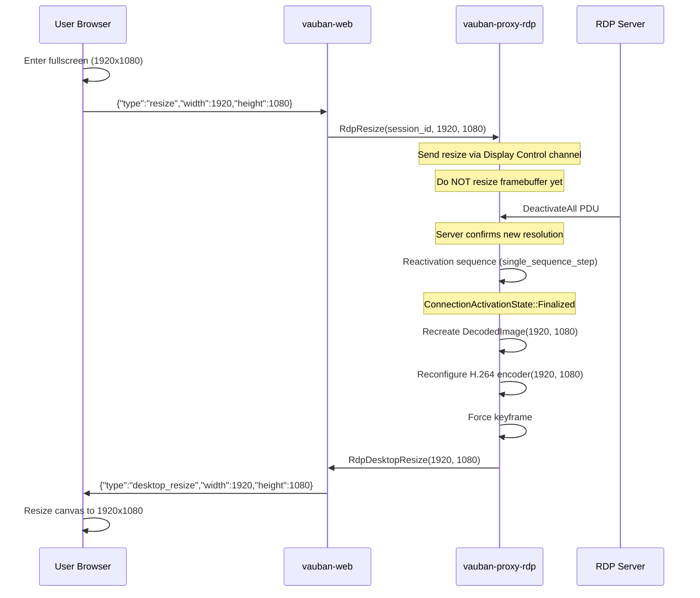

### 7.3 Race Condition Prevention

| Approach | Risk | Our Solution |
|----------|------|--------------|
| Resize framebuffer on `SessionCommand::Resize` | Server still sends at old resolution -> `index out of bounds` panic | Defer to `DeactivateAll` handler |
| Reconfigure encoder on resize request | Encoder dimensions mismatch framebuffer -> corrupted frames | Reconfigure only after `Finalized` state |
| Force keyframe on resize | Old resolution keyframe confuses decoder | Force keyframe only after reconfiguration |

---

## 8. IPC Protocol

### 8.1 RDP Message Types

All messages are serialized using **bincode** and sent over Unix pipes (see [Privsep Architecture, Section 4](Vauban_Privsep_Architecture_EN(1.3).md#4-ipc-protocol)):

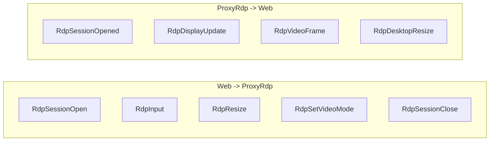

### 8.2 Key Message Definitions

| Message | Direction | Fields | Purpose |
|---------|-----------|--------|---------|
| `RdpSessionOpen` | Web -> Proxy | session_id, user_id, asset_id, host, port, username, password (SensitiveString), domain, desktop_width, desktop_height | Initiate RDP connection |
| `RdpSessionOpened` | Proxy -> Web | request_id, session_id, success, desktop_width, desktop_height, error | Connection result |
| `RdpDisplayUpdate` | Proxy -> Web | session_id, x, y, width, height, png_data | PNG bitmap region (fallback mode) |
| `RdpVideoFrame` | Proxy -> Web | session_id, timestamp_us, is_keyframe, width, height, data (H.264 NAL) | Encoded video frame |
| `RdpDesktopResize` | Proxy -> Web | session_id, width, height | Server confirmed new resolution |
| `RdpSetVideoMode` | Web -> Proxy | session_id, enabled | Enable/disable H.264 mode |
| `RdpInput` | Web -> Proxy | session_id, input (RdpInputEvent) | Mouse/keyboard event |
| `RdpResize` | Web -> Proxy | session_id, width, height | Request resolution change |
| `RdpSessionClose` | Web -> Proxy | session_id | Terminate session |

### 8.3 IPC Message Size

RDP messages, especially H.264 frames, can be larger than typical IPC messages. The `MAX_MESSAGE_SIZE` is set to **256 KB** to accommodate keyframes at very high resolutions (5K+) with complex graphical content, where I-frames can exceed 128 KB. This does not mean every message uses 256 KB -- delta frames are typically 1-5 KB, and most keyframes stay well under 100 KB at standard resolutions.

---

## 9. WebSocket Protocol

### 9.1 Connection

The frontend connects to `wss://host/ws/rdp/{session_id}` after the session is established. The WebSocket carries both text (JSON commands) and binary (display data) messages.

### 9.2 Capability Negotiation

Before video streaming begins, the browser announces its codec support:

```json
{"type": "capabilities", "video_codecs": ["avc1.42001f"]}
```

If the server detects `avc1` support, it enables H.264 mode and confirms:

```json
{"type": "mode", "video": true}
```

### 9.3 Binary Frame Formats

#### PNG Display Update (fallback mode)

```
Offset | Size | Description
-------|------|-------------
0-1    | 2    | x position (u16 LE)
2-3    | 2    | y position (u16 LE)
4-5    | 2    | width (u16 LE)
6-7    | 2    | height (u16 LE)
8+     | N    | PNG image data
```

#### H.264 Video Frame

```
Offset | Size | Description
-------|------|-------------
0      | 1    | Type marker: 0x01 (video frame)
1      | 1    | Flags: bit 0 = is_keyframe
2-5    | 4    | timestamp_ms (u32 LE)
6-7    | 2    | width (u16 LE)
8-9    | 2    | height (u16 LE)
10+    | N    | H.264 NAL unit data
```

The type marker (byte 0) distinguishes video frames from PNG updates. PNG frames do not have this marker -- the first byte is part of the x-coordinate, which is never `0x01` for typical display regions.

### 9.4 Text Messages

| Direction | Message | Purpose |
|-----------|---------|---------|
| Browser -> Server | `{"type":"mouse_move","x":...,"y":...}` | Mouse position |
| Browser -> Server | `{"type":"mouse_button","button":...,"pressed":...,"x":...,"y":...}` | Click/release |
| Browser -> Server | `{"type":"mouse_wheel","delta_x":...,"delta_y":...}` | Scroll |
| Browser -> Server | `{"type":"key","code":...,"key":...,"pressed":...,"shift":...,...}` | Keyboard |
| Browser -> Server | `{"type":"resize","width":...,"height":...}` | Resolution change |
| Browser -> Server | `{"type":"capabilities","video_codecs":[...]}` | Codec support |
| Server -> Browser | `{"type":"mode","video":true}` | H.264 mode confirmed |
| Server -> Browser | `{"type":"desktop_resize","width":...,"height":...}` | New resolution |

---

## 10. Frontend Client

### 10.1 Alpine.js Component

The `rdpViewer` Alpine.js component manages the entire client-side RDP experience:

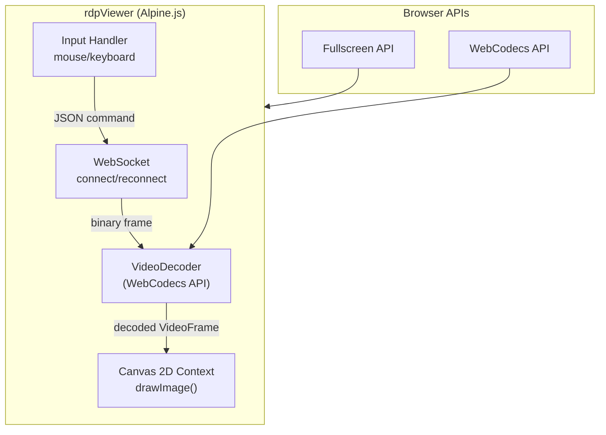

### 10.2 WebCodecs VideoDecoder

The browser uses the **WebCodecs API** for hardware-accelerated H.264 decoding:

```javascript
this.decoder = new VideoDecoder({
    output: (frame) => {
        this.ctx.drawImage(frame, 0, 0, frame.displayWidth, frame.displayHeight);
        frame.close();
    },
    error: (e) => console.error('[RDP] Decoder error:', e)
});

this.decoder.configure({
    codec: 'avc1.42001f',        // H.264 Baseline Level 3.1
    optimizeForLatency: true     // Minimize decode latency
});
```

Each incoming binary WebSocket frame is parsed and fed to the decoder:

```javascript
const chunk = new EncodedVideoChunk({
    type: isKeyframe ? 'key' : 'delta',
    timestamp: timestampMs * 1000,   // microseconds
    data: nalData
});
decoder.decode(chunk);
```

### 10.3 Rendering Modes

| Mode | Trigger | Rendering |
|------|---------|-----------|
| **PNG (fallback)** | Browser lacks WebCodecs or H.264 not negotiated | Individual bitmap regions drawn via `Image` + `drawImage(img, x, y)` |
| **H.264 (video)** | Browser sends `avc1.42001f` in capabilities | Full-frame decode via `VideoDecoder` + `drawImage(frame, 0, 0, w, h)` |

---

## 11. Security Design

### 11.1 Credential Handling

RDP credentials follow Vauban's defense-in-depth approach:

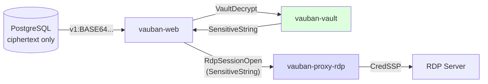

1. Encrypted credentials are stored in PostgreSQL (`v1:BASE64...`)
2. `vauban-web` requests decryption from `vauban-vault` via IPC
3. Plaintext is wrapped in `SensitiveString` (zeroize-on-drop) during IPC transport
4. `vauban-proxy-rdp` uses the credential for CredSSP authentication
5. The plaintext is zeroized after the RDP handshake completes

### 11.2 Bitrate Injection

The H.264 encoder bitrate is a security-sensitive configuration parameter. A compromised `vauban-web` could theoretically send an arbitrary bitrate via IPC to affect proxy resource consumption.

**Solution**: The supervisor injects the bitrate as an environment variable at fork time. The proxy reads and immediately destroys it:

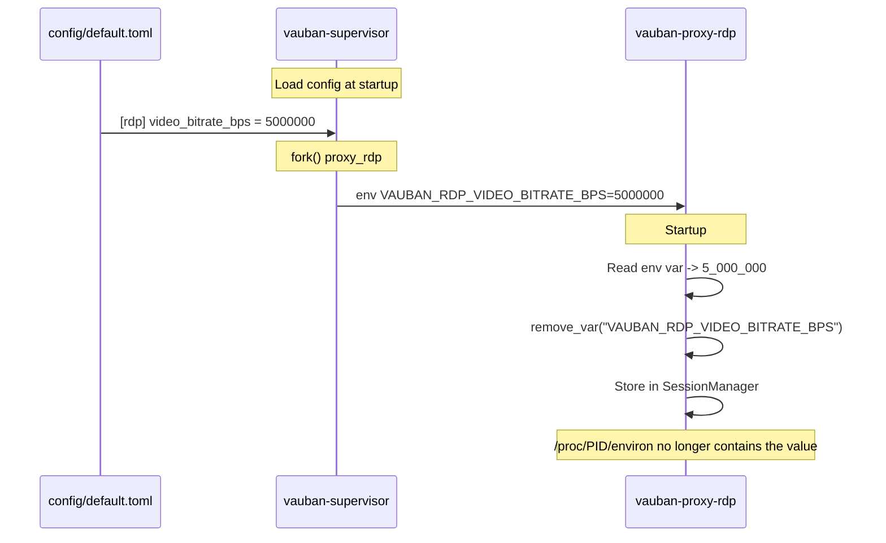

The `RdpSetVideoMode` IPC message carries only `session_id` and `enabled` -- no bitrate field. The proxy uses its internally stored value, preventing any IPC-based override.

### 11.3 Capsicum Sandboxing

After entering capability mode, `vauban-proxy-rdp` can only:

| Action | Possible? | Why |
|--------|-----------|-----|
| Open new TCP connections | No | Connections brokered by supervisor via SCM_RIGHTS |
| Read filesystem | No | `cap_enter()` blocks `open()` |
| Resolve DNS | No | Handled by supervisor |
| Communicate with vauban-web | Yes | Pre-opened IPC pipe |
| Communicate with supervisor | Yes | Pre-opened IPC pipe |
| Communicate with vault | Yes | Pre-opened IPC pipe |
| Communicate with audit | Yes | Pre-opened IPC pipe |
| Communicate with vauban-access (RBAC re-check) | Yes | Pre-opened IPC pipe enrolled via `AccessGuardWiring::fds` (see §11.5) |

The RBAC re-check pipe FDs are obtained from
`shared::access_guard::AccessGuard::from_env(...)` BEFORE the sandbox
seals, then enrolled via `AccessGuardWiring::fds` into
`setup_service_sandbox_extended(...)`. After `cap_enter()` the proxy
can read/write the access pipe but cannot acquire any new resource —
the dispatcher and `authorize()` calls run entirely on pre-opened FDs.

#### 11.3.1 Kerberos KDC FD-pass (every Kerberos mode)

An RDP asset has one of four NLA authentication modes. What a mode
means on the wire is one table, `auth_mode_profile` in
`vauban-proxy-rdp/src/session.rs`:

| Mode (`rdp_auth_mode`) | X.224 flag | TSCredentials | Package | For |
|---|---|---|---|---|
| `ntlm` | none | identity | NTLM | local accounts, hosts outside a domain |
| `kerberos` | none | identity | Kerberos only | domain accounts that are not local administrators of the target |
| `kerberos_restricted_admin` | `RESTRICTED_ADMIN_MODE_REQUIRED` | empty | Kerberos only | local administrators of the target |
| `kerberos_remote_guard` | `REDIRECTED_AUTHENTICATION_MODE_REQUIRED` | a service ticket and a TGT without its key | Kerberos only | any domain account |

The profile holds one value per mode, what the target receives
(`TargetCredentials`: the password, nothing, or Remote Credential
Guard credentials). The negotiation flag, the flag the target must
announce back, the CredSSP mode and the fate of the password in the
Client Info PDU are all computed from it, so no two of them can
disagree.

No Kerberos mode falls back to NTLM: the SPNEGO package list is
`kerberos` alone, so a target that selects NTLM fails the CredSSP
sequence. In `kerberos` the password is delegated to the target inside
CredSSP, as in `ntlm`; what changes is that the target is authenticated
by a service ticket and no NTLM response crosses the network.
`kerberos_restricted_admin` and `kerberos_remote_guard` keep the
password off the target. The first is reserved to local administrators
of the target and gives the session the identity of the target machine
on the network. The second serves any domain account: see
"Remote Credential Guard" below.

**Turning NTLM off.** `[rdp] ntlm_policy` is `"allow"` (default) or
`"deny"`. Under `deny`, a session is opened only for an asset in a
Kerberos mode; an asset in `ntlm`, with no stored mode, or with a value
outside the closed set is refused, including assets created before the
switch. The rule is `NtlmPolicy::permits(mode)` in `shared`, applied in
two places:

1. `connect_rdp` in vauban-web, after the access rules and before any
   session record, token or proxy request. It audits `RdpAuthFailed`
   with the reason `ntlm_forbidden`.
2. `vauban-proxy-rdp` at `RdpSessionOpen`, before the Kerberos
   pre-flight and the credentials. A compromised web tier therefore
   cannot reopen NTLM. The supervisor hands the policy to the proxy in
   `VAUBAN_RDP_NTLM_POLICY`, which the proxy removes from its
   environment after reading it.

A value other than `allow` or `deny` is never read as `allow`: the
supervisor and vauban-web fail to load their configuration, and the
proxy exits if the variable it receives is absent or not canonical.
Before the proxy has read its policy, its answer is `deny`.

Under `deny` the asset forms disable the NTLM option and state why. The
write paths still accept `ntlm` (an API client is told at session open,
not at write time). The access-posture tile of the dashboard shows
`RDP assets on NTLM` as `n/total`, in amber while `n` is not zero: the
assets to migrate before switching to `deny`.

**Setting the mode.** The mode and the domain are stored in
`connection_config` (`rdp_auth_mode`, `domain`) and written through two
paths that share one validator, `services::rdp_auth_mode::resolve`:

- the asset form (`/assets/manage/new`, `/assets/manage/{uuid}/edit`);
- the JSON API: `POST /api/v1/assets/manage` and
  `PUT /api/v1/assets/manage/{uuid}` accept `rdp_auth_mode` and
  `rdp_domain`; `GET /api/v1/assets/manage/{uuid}` returns them under
  `connection_config`.

```json
{
  "name": "srv01",
  "hostname": "srv01.corp.example.com",
  "asset_type": "rdp",
  "rdp_auth_mode": "kerberos",
  "rdp_domain": "corp.example.com"
}
```

Rules, identical on both paths:

- `rdp_auth_mode` is one of `ntlm`, `kerberos`,
  `kerberos_restricted_admin`, `kerberos_remote_guard`. Any other value
  is refused (HTTP 400 on
  the API, a flash error on the form). It is never stored as `ntlm`.
- Absent on create, the mode is `ntlm`. Absent on update, the stored
  mode and domain are kept; an empty `rdp_domain` clears the domain.
- A Kerberos mode requires a fully-qualified DNS hostname (labels of
  letters, digits, hyphens and underscores; no IP address in any form,
  no port, no trailing dot: the name becomes the SPN) and the DNS name
  of the domain. The check runs on the values the asset will have after
  the write, so changing only the hostname of a Kerberos asset to an IP
  address is refused.
- The two fields are refused on an asset that is not RDP.

The administration command that replaced a whole `connection_config`
(`UpdateAssetConnectionConfig`) is refused by `vauban-web`: it had no
sender, and a document computed from an older copy removed a pin or a
mismatch flag stored since. The form and the API are the only ways to
change the mode or the domain.

The admin asset list (`/assets/manage`) shows the mode of each RDP
asset as a badge: `NTLM` in amber, `Kerberos` and `Kerberos RA` in
green.

**NLA is mandatory, in every mode.** The X.224 security negotiation is
cleartext and precedes TLS, and the proxy advertises TLS next to NLA. A
target, or anyone on the path, can therefore answer "TLS only"; IronRDP
accepts that answer and skips CredSSP, after which the password would
go to the target in the Client Info PDU with no NLA at all. The proxy
refuses to go on (`check_negotiation`, before the TLS upgrade, reason
`negotiation_refused`) unless the target selected `HYBRID` or
`HYBRID_EX`, and, in Restricted Admin, set
`RESTRICTED_ADMIN_MODE_SUPPORTED` in its response ([MS-RDPBCGR]
2.2.1.2.1). `connect_finalize` refuses again if CredSSP is not about to
run. Consequence: a target that cannot do NLA (for example xrdp
without it) is no longer reachable, in the NTLM mode either. This is a
behavior change of 0.9.50.

**The Client Info PDU.** After CredSSP, RDP sends the Client Info PDU
(`TS_INFO_PACKET`), which IronRDP fills with the configured user name
and password. In `kerberos_restricted_admin` and
`kerberos_remote_guard` the proxy removes the password from that
configuration as soon as the CredSSP client has taken its own copy
(`strip_client_info_password`, in `perform_credssp_step`, before any
I/O), so the target receives no password, neither in TSCredentials nor
in the Client Info PDU. In `kerberos` and `ntlm` the password is
delegated by design and the PDU carries it.

**Remote Credential Guard (`kerberos_remote_guard`).** The mode opens a
session for any domain account without giving the target anything it
can reuse. Instead of a password, the CredSSP exchange carries
`TSRemoteGuardCreds`: a ticket for the computer account of the target
(`HOST/<fqdn>`) and a forwarded TGT whose session key is replaced by a
handle. The key stays in the proxy.

1. The X.224 Connection Request carries
   `REDIRECTED_AUTHENTICATION_MODE_REQUIRED`. A target that does not
   answer `REDIRECTED_AUTHENTICATION_MODE_SUPPORTED` is refused
   (`negotiation_refused`) before any ticket is sent.
2. CredSSP runs with the Kerberos package only, in
   `CredSspMode::RemoteGuard`. The KDC exchanges go through the
   supervisor broker, as in the other Kerberos modes: an AS exchange,
   then three ticket requests (`TERMSRV/<fqdn>`, `HOST/<fqdn>`, and the
   forwarded TGT). The asset hostname must therefore be the name under
   which the target's computer account is registered.
3. Once the target has accepted the logon, the Kerberos context of the
   exchange becomes the session that answers the target
   (`sspi::rcg::RemoteGuardSession`). The proxy installs it on the
   dynamic channel carrier, as the backend of the
   `Microsoft::Windows::RDS::AuthRedirection` channel ([MS-RDPEAR]),
   behind its own policy (`attach_remote_guard_channel`). No other
   mode installs that channel.
4. For as long as the session is open, each time the target needs
   Kerberos for the user it asks the proxy for the operations that need
   the key. The target talks to the KDC itself; the proxy only
   computes. The KDC broker is not used after the logon.

The connector is not told about the mode: it would run CredSSP itself,
with a package list the proxy does not control. The proxy sets the
flag, checks the answer, drives CredSSP and installs the channel. The
channel backend (framing, NDR decoding, version negotiation, status
codes) is the proxy's own, `remote_guard_channel.rs`, with its
decision point, `remote_guard::PolicyContext`.

*Outbound identity.* What the proxy answers is a bastion-wide setting,
`[rdp] remote_guard_outbound_identity`:

| Value | The proxy | From the session, the user |
|---|---|---|
| `"deny"` (default) | answers the version negotiation the logon needs, and refuses every other operation with `STATUS_NOT_SUPPORTED` | has no identity on the network: no service ticket is obtained, and a ticket already held cannot be used, because each use needs an authenticator from the proxy |
| `"allow"` | performs the operations | reaches other services as themselves, for as long as the session is open |

The setting follows the model of `ntlm_policy`: a closed set read
exactly, a value outside it stops the supervisor and vauban-web at
load, the supervisor hands it to the RDP proxy alone in
`VAUBAN_RDP_REMOTE_GUARD_OUTBOUND_IDENTITY`, the proxy reads it once,
removes it from its environment, exits if it is absent or not
canonical, and answers `deny` before it is read. A change takes effect
when the proxy restarts; a session keeps the value it was opened with.
vauban-web reads the key to show it, read-only, on the asset forms. It
decides nothing with it. `"services"`, a list of reachable services, is
planned and is refused until it is implemented.

Under `deny` a Windows target keeps asking, about once per second. The
proxy answers each request and writes one log line for the first
refusal of a session, then a count every five minutes.

*Redirected NTLM* is never granted, under either value: no Kerberos
mode reaches NTLM. The CredSSP client is never given an NTLM
supplemental credential, and the policy context reports NTLM as
unavailable, so the backend refuses every NTLM request, its version
negotiation included. From such a session a resource reached by IP
address is therefore not accessible, whatever the setting.

*What is logged.* At the logon, the value of the setting. Under
`allow`, each ticket the target requests (`ComputeTgsChecksum`: the
service named in the request body) and each ticket it obtains
(`UnpackKdcReplyBody`: the service named in the KDC reply), with the
session identifier. A service name is chosen by the target or relayed
by the KDC: it is reduced to printable ASCII, bounded, and written
through the single-line log writer. No other argument of a request is
logged: they are keys, or are encrypted with one.

*Request-loop guard.* A target whose Kerberos module does not accept
the proxy's responses asks for the same operations without end and
never brings back a KDC reply. Under `allow`, the proxy counts the
ticket requests it answered since the last KDC reply; at 240 within 60
seconds it logs the cause, closes the channel (the keys are erased)
and the session ends. A working logon is a few tens of operations.

*What changes for the threat model.*

- The proxy keeps the key of the user's TGT for the whole session. In
  every other mode it holds no Kerberos secret once the session is
  open.
- Under `allow`, a compromised target can act on the network as the
  user for as long as the session is open. The bastion is the one that
  signs. It obtains nothing it can use after the session ends.
- Under `deny`, the proxy signs nothing for the target.
- Every message on the channel is untrusted input: bounded in size,
  decoded strictly, and any protection error closes the channel and
  erases the keys.

*Target support.* The redirected Kerberos responses carry the slot of
their ASN.1 type in the target's Kerberos module (`KERB_ASN1_DATA.Pdu`).
The values used are those of Windows versions up to Server 2022, with
the shifted value for newer modules taken from the FreeRDP `rdpear`
channel. The first set was checked against a domain-joined Windows
target on 2026-11-21; the shifted one is not checked. A target that
needs a value the proxy does not send is the case the request-loop
guard closes.

In every Kerberos mode, sspi issues `NetworkRequest` TCP exchanges (typically AS-REQ then TGS-REQ for `TERMSRV/<fqdn>`). The
sealed proxy cannot `connect()` to the KDC, so each request leases a
connected socket from the supervisor:

1. Proxy sends `KerberosKdcLeaseRequest { request_id, session_id,
   realm }` — a realm, **not** a payload and **not** a host.
2. Supervisor (`kdc_broker::select_endpoints`) validates the realm
   (`shared::kerberos::normalize_realm`) and looks it up in the
   `[auth.kerberos]` realm table. An unknown or malformed realm is
   refused before any socket is opened. It then connects **only** to
   the KDC hosts configured for that realm (SSRF-safe; token-less;
   caller must be `proxy_rdp`), `send_fd` via SCM_RIGHTS, then
   `KerberosKdcResponse { success, data: empty }`.
3. Proxy `recv_fd_timed`, performs framed Kerberos TCP I/O locally
   (`kdc_framed_round_trip`, `MAX_KDC_REPLY = 256 KiB`), closes the FD.

**Failure reasons.** A failed NLA leg leaves the proxy as
`RdpSessionOpenFailed { reason: RdpAuthFailure, rdp_auth_mode }`: a
closed-set reason and the mode, with no text. The error text can quote
the KDC or the target, so it stays in the `vauban-proxy-rdp` log, keyed
by session id. `auth_failure::classify` computes the reason from typed
evidence only, most specific first:

1. the KDC socket lease (the supervisor prefixes a refusal with a
   `KdcLeaseRefusal` code: realm not configured, KDC unreachable,
   brokering disabled);
2. the error code of the last KDC reply, read from the KRB-ERROR on the
   leased socket. `sspi` folds a wrong password and an unknown SPN into
   kinds that name neither, so the code is read here and nowhere else;
3. an AS-REP answering an AS-REQ without pre-authentication (an account
   exempt from pre-authentication, which `sspi` does not support);
4. the `sspi` error kind and the CredSSP status of the target.

| Reason | Evidence | Operator action |
|---|---|---|
| `kdc_unreachable` | lease failed, or `sspi` found no KDC | KDC hosts and port, network path |
| `realm_not_configured` | lease refused for the realm | `[[auth.kerberos.realms]]` |
| `realm_invalid` | pre-flight, or KDC code 68 | DNS name in the asset `Domain` field |
| `kerberos_broker_unavailable` | brokering disabled, no relay | `[auth.kerberos] enabled` |
| `clock_skew` | KDC code 37, or `sspi` `TimeSkew` | NTP |
| `pre_auth_failed` | KDC code 24 | stored password |
| `client_principal_unknown` | KDC code 6 | username, domain |
| `service_principal_unknown` | KDC code 7 | asset FQDN, `setspn -Q TERMSRV/<fqdn>` |
| `account_disabled_or_locked` | KDC code 18 | account state in the domain |
| `password_expired` | KDC code 23 | password change |
| `encryption_type_unsupported` | KDC code 14 | enable AES on the account or service |
| `pre_auth_not_required` | first KDC reply is an AS-REP | clear the pre-authentication exemption |
| `restricted_admin_refused` | logon refused in Restricted Admin mode | `DisableRestrictedAdmin = 0`, local administrator |
| `remote_guard_refused` | logon refused in Remote Credential Guard mode | Remote Desktop logon right, Remote Credential Guard accepted by the target, `setspn -Q HOST/<fqdn>` |
| `credentials_rejected` | logon refused in another mode | credentials, Remote Desktop logon right |
| `kerberos_package_refused` | Kerberos mode, token the client cannot use, no service ticket issued | target joined to the domain |
| `target_token_rejected` | Kerberos mode, the KDC answered the whole exchange without an error (at least three replies), then the client refused a token of the target | the cause after `caused by:` in the proxy log; not the account, the realm or the SPN |
| `negotiation_refused` | any mode: the target refused the negotiation, selected TLS only, or (Restricted Admin) did not announce support | enable NLA on the target; check the network path |
| `ntlm_forbidden` | `[rdp] ntlm_policy = "deny"` and a mode that is not a Kerberos mode | switch the asset to a Kerberos mode |
| `other` | none of the above | proxy log for the session |

`restricted_admin_refused`, `remote_guard_refused`,
`credentials_rejected`, `kerberos_package_refused` and `target_token_rejected` are inferred
from how the target answers, not from a code that names the cause.
`target_token_rejected` (0.9.59) separates a target that answered in
Kerberos from one that could not: before it, a refused `mechListMIC`
was reported as `kerberos_package_refused`, with a message that
pointed at the domain join of a correctly joined target. The others
have not been checked against a real Active Directory.

The proxy logs the typed evidence of every NLA failure on a line `RDP
NLA failure evidence` (`sspi_kind`, `nstatus`, `kdc_replies`,
`kdc_last_error`, lease and relay flags: codes and counters, no text
from a peer), and the cause chain of the error on the `RDP session
refused` line. Both stay in the proxy log. `Connecting to RDP server`
and `RDP session connected` carry `auth_mode`.

**IronRDP from its main branch.** The `ironrdp-*` crates come from
`https://github.com/Devolutions/IronRDP`, pinned by commit in the
workspace `[patch.crates-io]`. Upstream main carries Remote Credential
Guard under the version numbers of the published crates, so no
published crate has it. The proxy leaves the connector's `remote-guard`
feature off and carries its own backend for the authentication
redirection channel (`remote_guard_channel.rs`, adapted from the
connector's private module), for three reasons. The feature brings the
DNS resolver of `sspi`, and the proxy reaches a KDC through the
supervisor broker only. The connector's backend cannot be installed
around the proxy's policy. And it returns `KERB_ASN1_DATA.Pdu` as 0 in
the redirected Kerberos responses: a Windows target decodes each
response with that slot, and with slot 0 it rejects them all, which
leaves the session without an outbound identity. The copy is compared
with the connector's module on every bump of the pin. `sspi` is 0.23.1 from crates.io. It holds the fix
of Devolutions/sspi-rs#772 (a Windows acceptor signs the SPNEGO
`mechListMIC` with sequence number 0 whatever its AP-REP announced;
the initiator no longer enforces that number and still verifies the
checksum), which the `sspi-rs-vb` fork carried from 0.9.58 until this
change. The entries are removed when a published IronRDP release
contains Remote Credential Guard;
`check_patch_pins.sh` keeps every `ironrdp-*` entry on that repository
and on one commit, refuses the connector's `remote-guard` feature, and
refuses an `sspi` entry.

vauban-web shows the cause and the action to a holder of `assets:manage`
and one generic sentence to anyone else
(`services::rdp_auth_failure::message_for`), and emits the audit event
`RdpAuthFailed` with the asset, the reason and the mode.

**Testing without Active Directory.** No domain controller is available
in CI. The CredSSP leg is covered by two harnesses in
`vauban-proxy-rdp/src/test_support`, both compiled for tests only:

- **In-process, in the default suite** (`session::credssp_loop_tests`).
  The production function `perform_credssp_step` runs with the
  production Kerberos network client against an in-memory KDC (ported
  from the test suite of `sspi`) and against `sspi`'s own CredSSP server
  standing in for the target. It checks that both Kerberos modes
  complete, that the target receives the identity in `kerberos` and
  empty TSCredentials in `kerberos_restricted_admin`, that a target
  offering only NTLM is refused without the client emitting an NTLM
  token, and that each failure yields its reason. A filter in the
  target loop (`test_support::windows_mic`) replaces the acceptor's
  `mechListMIC` with one numbered 0, signed with the acceptor's own
  key: both Kerberos modes complete against it, and the same token
  with an altered checksum is refused as `target_token_rejected`. The
  filter first reproduces the MIC `sspi` computed, so it cannot sign
  with the wrong key unnoticed. Against `sspi` 0.23.0 from crates.io
  the two completion tests fail with the error met in production.
  In `kerberos_remote_guard` the client leg completes against the
  same harness (four KDC exchanges, password absent from everything
  the client sent, redirection channel installed), and the test
  target, which authenticates the client but does not implement
  `TSRemoteGuardCreds`, refuses the last message. That mode asks for
  sequence detection, so the MIC numbered 0 is refused there: the
  filter does not stand for a Windows target in that mode.
- **Redirection channel, in the default suite** (`remote_guard::tests`).
  The proxy's policy context runs behind the connector's real channel
  backend, around a scripted context in place of the `sspi` session:
  version negotiation and refusals under `deny`, delegation under
  `allow`, NTLM refused under both, the request-loop guard, the
  reading and reduction of service names. A Windows target accepting
  the logon and using the channel is not covered in CI: see
  `docs/runbooks/rdp_remote_credential_guard_smoke_test.md`.
- **MIT KDC, opt-in** (`session::mit_kdc_tests`). A throwaway MIT realm
  on loopback. The proxy obtains a TGT from it through the production
  path: lease request, a stand-in supervisor that passes the connected
  socket over `SCM_RIGHTS`, framed I/O on the received descriptor.

  ```bash
  VAUBAN_TEST_MIT_KDC=1 cargo test -p vauban-proxy-rdp \
    -- --ignored mit_kdc --test-threads=1
  ```

  It needs `krb5kdc`, `kdb5_util` and `kadmin.local` (searched in
  `/opt/local/sbin`, `/usr/local/sbin`, `/usr/sbin`, or the directory
  named by `VAUBAN_TEST_MIT_KDC_SBIN`).

What these do not prove: the target is `sspi`'s server, not Windows,
and the in-memory KDC checks little. They validate how Vauban drives
`sspi`; interoperability with a domain controller and a Windows target
is the purpose of the live checklist in
`docs/runbooks/ironrdp_migration_smoke_test.md`. The MIT harness covers
the AS exchange only: the service-ticket exchange is user-to-user and
needs the target to be a principal of the same KDC.

One behavior the in-process harness surfaced: when the asset hostname
is a name the target does not answer to, the target refuses the
user-to-user ticket request before any KDC is asked, and the failure is
reported as `kerberos_package_refused`, not `service_principal_unknown`.
The latter is reported when the KDC itself does not know
`TERMSRV/<fqdn>`.

**Realm.** The realm is the asset's domain, validated as a DNS name and
upper-cased by `shared::kerberos::normalize_realm` (web form at write
time, proxy pre-flight at session open). A missing domain or a NetBIOS
short name fails the session; there is no NTLM fallback.

**Realm table and failover.** `[auth.kerberos]` holds one realm through
its `realm` / `kdc_host` keys and any number through
`[[auth.kerberos.realms]]`, each with an ordered `kdc_hosts` list.
`kdc_broker::connect_first_kdc` tries the hosts in order under one
`timeout_secs` budget, each host getting an equal share, so a dead first
domain controller does not consume the exchange. A failover is logged at
`warn`.

**Sentinel URL.** sspi's `NetworkRequest` carries a URL, not a realm.
The proxy hands sspi `tcp://<realm>.kdc.vauban.invalid:88` as the KDC of
the session realm; the name is never dialed (`.invalid` cannot resolve).
`KerberosRelayNetworkClient` reads the realm back from the URL and
refuses any URL that is not the sentinel of the session realm. A URL
produced by sspi's own KDC discovery (cross-realm referral, `krb5.conf`,
DNS SRV, `SSPI_KDC_URL*`) is therefore refused, not followed: cross-realm
referrals are unsupported and fail closed.

**Ambient configuration.** The supervisor removes `KRB5_CONFIG` and
`SSPI_KDC_URL*` from the environment its children inherit and starts the
RDP proxy with `KRB5_CONFIG=/dev/null`; the proxy refuses a Kerberos
session if that isolation does not hold.

**Wire compatibility.** The realm-less `KerberosKdcRequest` is still
accepted by the supervisor when exactly one realm is configured, so a
proxy from the previous release keeps working during a rolling upgrade.
Current proxies never send it. It is slated for removal one release
later.

Root never sees AS-REQ / TGS-REQ / ticket bytes. Demux is keyed by
`request_id` and is distinct from asset `pending_connections[session_id]`
and recording leases. Lint: `vauban-proxy-rdp/scripts/check_kerberos_kdc_fd.sh`.
Manual AD smoke: [`ironrdp_migration_smoke_test.md`](../runbooks/ironrdp_migration_smoke_test.md).

### 11.4 Environment Variable Hygiene

All environment variables are destroyed immediately after reading:

```rust
unsafe {
    std::env::remove_var("VAUBAN_IPC_READ");
    std::env::remove_var("VAUBAN_IPC_WRITE");
    std::env::remove_var("VAUBAN_WEB_IPC_READ");
    std::env::remove_var("VAUBAN_WEB_IPC_WRITE");
    std::env::remove_var("VAUBAN_FD_PASSING_SOCKET");
    std::env::remove_var("VAUBAN_RDP_VIDEO_BITRATE_BPS");
    std::env::remove_var("VAUBAN_ACCESS_IPC_READ");   // consumed by AccessGuard::from_env
    std::env::remove_var("VAUBAN_ACCESS_IPC_WRITE");  // consumed by AccessGuard::from_env
}
```

This prevents environment inspection attacks (e.g., `/proc/PID/environ` on Linux, `ps eww` on FreeBSD).

### 11.5 Defense-in-Depth RBAC Re-check (`shared::access_guard`)

`vauban-proxy-rdp` does **not** trust the verdict from `vauban-web` to
authorize an upstream RDP connection. On every `RdpSessionOpen`, it
issues an independent `AccessRequest::CheckAccessByUuid` directly to
`vauban-access` via the shared `shared::access_guard` module:

| Property | Value |
|----------|-------|
| Module | `shared::access_guard` (feature `access-guard`) |
| Constructor | `AccessGuard::from_env(PROTOCOL_RDP, state)` (boot fail-closed if env var missing) |
| Hot-path call | `access_guard_clone.authorize(&user_uuid, &asset_uuid).await` |
| Wraps in | `tokio::spawn` (the proxy's main loop must NEVER block on the re-check) |
| Hard timeout | 10 s (`shared::access_guard::RBAC_RECHECK_TIMEOUT`) |
| Return type | `AccessDecision` — never `Result` (no `?`-fail-open path) |
| Variants | `Granted` (proceed) \| `Denied` \| `Timeout` \| `BackendError(_)` (all collapse to `"Access denied"` to the user) |
| Metrics callbacks | `record_granted` / `record_denied` / `record_timeout` / `record_ipc_error` on `ServiceState` (see `impl AccessGuardMetrics for ServiceState` in `vauban-proxy-rdp/src/main.rs`) |

The pattern is **identical** to `vauban-proxy-ssh`'s wiring; the only
differences are `PROTOCOL_RDP` vs `PROTOCOL_SSH` and the response
message variant (`RdpSessionOpened { success: false, error: Some("Access denied") }`
vs `SshSessionOpened`).

The full module API, threat model, the RAII pending-map fix that
prevents resource leaks under timeout / cancellation, the type-system
invariants, and the 30+ test inventory are documented in
[Vauban_AccessGuard_Architecture_EN(1.0).md](Vauban_AccessGuard_Architecture_EN(1.0).md).
Operational triage of `rbac_recheck_timeouts` and the `proxy-rdp <->
access` pipe is in
[docs/runbooks/ipc_topology_debugging.md](../runbooks/ipc_topology_debugging.md).

### 11.6 Server-Certificate Pinning (SPKI + TOFU)

Earlier, `vauban-proxy-rdp` upgraded the TCP channel to the
target with an accept-any TLS verifier (`NoCertificateVerification`).
Because CredSSP relays the user's domain credentials over that TLS
channel, a network attacker positioned between the bastion and the
asset could terminate the TLS session, present any certificate, and
capture the relayed credentials -- a classic man-in-the-middle. The
pre-fix verifier made this attack trivial: the proxy never checked
*which* server it was talking to.

The remediation pins the target server's **`SubjectPublicKeyInfo`
(SPKI)** and mirrors, end-to-end, the existing SSH host-key pinning
workflow (Trust-On-First-Use with explicit admin reconfirmation on
change, plus a fail-closed connect-time pre-flight).

#### What is pinned

The pin is the `SHA256:<base64>` digest of the **complete
`SubjectPublicKeyInfo` DER** (algorithm identifier + public key), not
just the raw public-key BIT STRING. Hashing the full SPKI:

- prevents key/algorithm-confusion across certificate renewals, and
- stays stable when a Windows host renews its self-signed RDP
  certificate **while reusing the same key pair**.

When Windows regenerates the key pair as well, the new SPKI legitimately
differs from the pin -- this surfaces as a mismatch and is resolved by
the admin "Accept New Certificate" step, exactly like SSH "host key
changed".

| `connection_config` JSON key | Meaning |
|------------------------------|---------|
| `rdp_server_cert_fingerprint` | `SHA256:<base64>` of the pinned SPKI (comparison + display) |
| `rdp_server_cert_spki` | base64 of the SPKI DER (forensic / display) |
| `rdp_server_cert_mismatch` | optional bool; blocks connections + drives the red UI |

#### Session path (fail-closed)

`build_tls_config(expected_fingerprint)` installs a
`PinningServerCertVerifier` that:

1. extracts the live `end_entity` SPKI, computes its `SHA256:<base64>`
   fingerprint, and compares it against the pin in **constant time**;
   a mismatch returns a `rustls` error whose wording carries
   `certificate mismatch` / `MITM` so the web layer can flip
   `rdp_server_cert_mismatch`;
2. still verifies the TLS handshake signature by delegating to the
   `aws_lc_rs` `CryptoProvider`
   (`verify_tls12_signature` / `verify_tls13_signature` +
   `supported_verify_schemes`). Pinning the SPKI without verifying the
   signature would accept a certificate the server cannot prove it owns;
   delegating the signature check is strictly stronger than the pre-fix
   `assertion()`.

TLS resumption stays disabled (CredSSP does not support it).

`vauban-web`'s `connect_rdp` enforces a **pre-flight gate** before any
`proxy_sessions` row is created: it refuses with
*"No RDP server certificate pinned for this asset..."* when nothing is
pinned and *"RDP server certificate mismatch detected on previous
connection..."* when the mismatch flag is set. The proxy therefore
never opens an upstream session against an unverified or
previously-mismatched target.

#### Fetch path (TOFU, accept-any confined)

The admin "fetch + pin" workflow uses a dedicated
`fetch_server_cert(host, port, fd)` that drives the X.224 negotiation,
upgrades to TLS with a **`TofuAcceptAnyFetchVerifier`** (accept-any,
because nothing is pinned yet -- exactly like SSH `fetch_host_key`
accepting the live key on first contact), extracts the SPKI, and closes
the socket **without** performing CredSSP / NLA. Security is provided
downstream: the admin reviews the fingerprint before pinning, and the
session path enforces the pin fail-closed. The accept-any verifier is
referenced **only** by the fetch path and is locked there by the
`check_rdp_cert_paths.sh` lint.

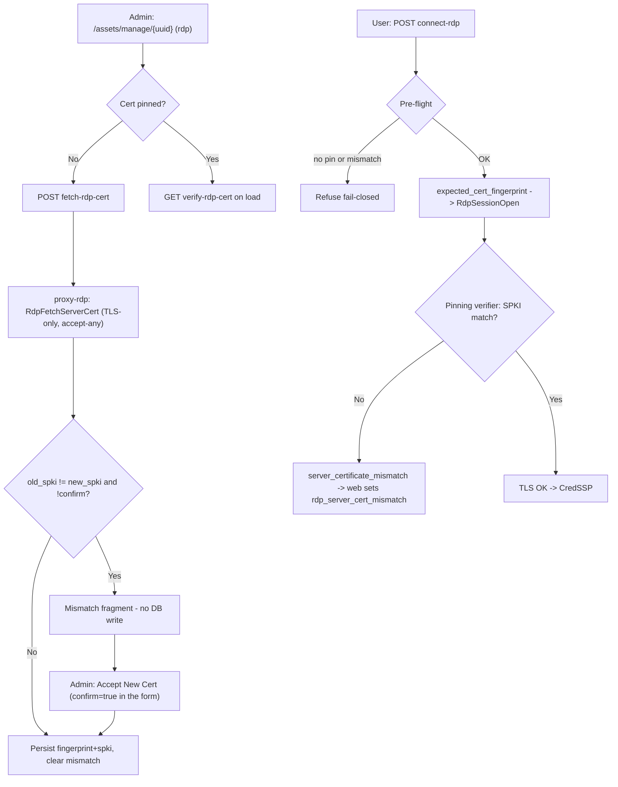

#### Pin requests carry the CSRF token (0.9.51)

`POST /assets/manage/{uuid}/fetch-rdp-cert`, like its SSH counterpart
`fetch-host-key`, sets a trust anchor. Both handlers take
`PinTrustAnchorForm` and validate the double-submit CSRF token before
anything else. The confirmation that replaces a changed pin is the
`confirm` field of that form; a `confirm` in the query string is not
read. The fragments send both through `hx-vals`.
`check_pin_routes_csrf.sh` and `tests/web/pin_csrf_test.rs` pin this,
and the test file also checks that every state-changing route of the
web zone validates the token.

#### What a proxy returns is checked and escaped (0.9.51)

The key, the SPKI, and the fingerprint a proxy returns are stored on the
asset and shown in the admin pages. vauban-web refuses an answer that is
not shaped like them (`services::pin_shape`: `SHA256:` plus base64, a
base64 SPKI, an OpenSSH key line), and every value placed into a pin
fragment is HTML-escaped (`html_text`). The fragments are plain files
with placeholders, not templates, so nothing else escapes for them.

#### A mismatch is a typed signal (0.9.51)

The pinning verifier sets a flag when it refuses a certificate for a
pin mismatch. The session code reads the flag after a failed handshake
and reports `server_certificate_mismatch`, one of the closed-set codes
of Appendix B. vauban-web sets `rdp_server_cert_mismatch` on that exact
code only. Before 0.9.51 it searched the text of the error for
"certificate mismatch" or "MITM", so text written by the target could
mark an asset as mismatched.

#### Privilege separation

The fetch TCP connection is brokered by the supervisor under the
`fetch-rdpcert-{request_id}` identity and authorized by a diagnostic
token (`issue_diagnostic_token`, `protocol = "rdp"`) for callers with
`assets:manage`, so the sandboxed proxy never opens a socket itself --
identical to the SSH host-key fetch broker.

---

## 12. Testing Strategy

### 12.1 Unit Tests (vauban-proxy-rdp)

#### Video Encoder (`video_encoder.rs`)

| Test | Purpose |
|------|---------|
| `test_encoder_creation` | Encoder initializes with valid dimensions |
| `test_encode_black_frame` | Solid black framebuffer produces valid H.264 |
| `test_first_frame_is_keyframe` | First encoded frame is always an I-frame |
| `test_subsequent_frames_are_delta` | Following frames are P-frames |
| `test_force_keyframe` | `force_intra_frame()` produces an I-frame on demand |
| `test_reconfigure_dimensions` | Encoder adapts to new resolution |
| `test_custom_bitrate` | Custom bitrate is accepted |
| `test_h264_nal_start_code` | Output starts with `0x00 0x00 0x00 0x01` (Annex B) |
| `test_timestamps_increase` | Frame timestamps are monotonically increasing |

#### Session (`session.rs`)

| Test | Purpose |
|------|---------|
| `test_align_even_*` | Dimension alignment for H.264 compatibility |
| `test_encoder_thread_handles_odd_dimensions` | Odd resolution padded correctly |
| `test_encoder_thread_reconfigure_odd_dimensions` | Reconfigure with odd resolution |
| `test_encoder_thread_exact_fullscreen_scenario` | Real-world 1728x1117 -> 1728x1118 |
| `test_encoder_thread_custom_bitrate` | Thread uses provided bitrate |
| `test_encoder_thread_zero_bitrate_uses_default` | Zero bitrate falls back to 5 Mbps |
| `test_encode_region_as_png_full_screen` | PNG fallback produces valid output |

#### Session Manager (`session_manager.rs`)

| Test | Purpose |
|------|---------|
| `test_session_manager_default_bitrate` | Default is 5 Mbps |
| `test_session_manager_custom_bitrate` | Constructor accepts custom value |
| `test_session_manager_bitrate_used_in_set_video_mode` | Structural: uses `self.video_bitrate_bps` |

### 12.2 Structural Regression Tests

These tests inspect the source code at compile time to prevent architectural regressions:

| Test | Assertion |
|------|-----------|
| `test_resize_handler_does_not_recreate_framebuffer` | `Resize` handler must NOT contain `DecodedImage::new` |
| `test_deactivate_all_reconfigures_encoder` | `DeactivateAll` handler must contain `EncoderCommand::Reconfigure` and `ForceKeyframe` |
| `test_align_even_used_in_encoder_thread` | `spawn_encoder_thread` must call `align_even` and `.resize(expected,` |
| `test_bitrate_env_var_read_and_destroyed` | Source must contain `remove_var("VAUBAN_RDP_VIDEO_BITRATE_BPS")` |
| `test_bitrate_not_received_from_ipc` | `RdpSetVideoMode` handler must ignore `bitrate_bps` from IPC |
| `test_session_manager_created_with_bitrate` | Source must contain `SessionManager::with_bitrate(video_bitrate_bps)` |

### 12.3 WebSocket Handler Tests (vauban-web)

| Test | Purpose |
|------|---------|
| `test_rdp_command_mouse_move` | JSON deserialization of mouse move |
| `test_rdp_command_mouse_button_*` | Button press/release variants |
| `test_rdp_command_mouse_wheel_*` | Scroll events |
| `test_rdp_command_key_*` | Key events with modifiers |
| `test_rdp_command_resize` | Resize command parsing |
| `test_rdp_command_capabilities_*` | H.264 capability negotiation |
| `test_rdp_command_invalid_type` | Malformed commands rejected |

### 12.4 IPC Serialization Tests (shared)

| Test | Purpose |
|------|---------|
| `test_message_rdp_session_open` | Roundtrip serialization with SensitiveString |
| `test_message_rdp_display_update` | PNG data survives bincode |
| `test_message_rdp_video_frame` | H.264 NAL data survives bincode |
| `test_message_rdp_set_video_mode` | Enabled/disabled variants |

### 12.5 Supervisor Tests

| Test | Purpose |
|------|---------|
| `test_rdp_config_loaded_from_toml` | `video_bitrate_bps` parsed from `default.toml` |
| `test_service_env_vars_proxy_rdp` | `VAUBAN_RDP_VIDEO_BITRATE_BPS` generated for `proxy_rdp` |
| `test_service_env_vars_other_services_empty` | Other services get no RDP env vars |
| `test_spawn_child_accepts_service_env_vars` | Structural: `spawn_child` has the parameter |
| `test_all_spawn_call_sites_pass_service_env_vars` | All 3 spawn sites pass `&svc_env` |

### 12.6 Server-Certificate Pinning Tests

Five complementary layers cover the SPKI pinning surface, mirroring the
SSH host-key coverage:

| Layer | Location | Coverage |
|-------|----------|----------|
| Lint + Rust wrapper | `scripts/check_rdp_cert_paths.sh`, `tests/web/rdp_cert_lints_test.rs` | Forbids `NoCertificateVerification` on the session path; requires `PinningServerCertVerifier`, the two pre-flight literals, the amber fallback fragment, and the diagnostic-token routing |
| Source grep | `tests/web/rdp_cert_no_silent_green_test.rs` | Green fragment only inside the `old_spki == remote_spki` branch; pre-flight literals before the first `proxy_sessions` insert |
| E2E HTTP (`proxy = None`) | `tests/web/rdp_cert_pin_e2e_test.rs` | Cases A-E: amber when proxy down, red on stored mismatch, no-key when absent; `connect-rdp` refuses (0 rows) without a pin and on mismatch |
| Behavioral (proxy-rdp, `rcgen` TLS) | `session.rs::tests::vau001_cert_pinning` | Deterministic SPKI fingerprint, constant-time compare, verifier accept/reject (MITM wording), real handshake succeeds on match and **fails** on mismatch |
| Satellites | `tests/security/security_test.rs` | IPC wire format, proxy verifier, web handlers and IPC client grep pins |

---

## 13. Architecture Decisions

### 13.1 Summary of Key Decisions

| Decision | Choice | Rationale |
|----------|--------|-----------|
| RDP library | IronRDP (pure Rust, async) | Memory-safe, auditable, Tokio-native |
| Video encoding | OpenH264 (H.264 Baseline) | Software-only, no GPU dependency, universal browser support |
| Browser decoding | WebCodecs API | Hardware-accelerated, sub-millisecond latency |
| Encoding thread | Dedicated `std::thread` | Prevents async runtime blocking during encode |
| Framebuffer model | Full-frame snapshot on dirty flag | Simpler than tile-based; quality > bandwidth optimization |
| Resize synchronization | Deferred to `DeactivateAll` | Prevents race condition with server |
| Bitrate configuration | Supervisor-injected env var | Security: vauban-web cannot override encoder settings |
| PNG fallback | Per-region bitmap updates | Baseline support for browsers without WebCodecs |
| Input throttling | Client-side, 33ms for mouse | Prevents IPC flooding; keyboard unthrottled |
| Coordinate mapping | Client-side scaling | Decouples canvas size from desktop resolution |

### 13.2 Performance Characteristics

| Metric | Typical Value | Conditions |
|--------|---------------|------------|
| Encode FPS | 35-40 | 1280x720, software encoding |
| GFX updates/5s | 30-50 | Active desktop use |
| Avg encode latency | 25-35 ms | Per frame, dedicated thread |
| H.264 keyframe size | 10-50 KB | Depends on desktop content |
| H.264 delta frame size | 1-5 KB | Small changes only |
| WebSocket latency | < 1 ms | Local network |
| Input round-trip | < 50 ms | Mouse click to visual feedback |

### 13.3 Known Limitations

| Limitation | Root Cause | Mitigation |
|------------|------------|------------|
| Text clarity in fullscreen | H.264 Baseline + YUV 4:2:0 chroma subsampling | Increase bitrate via TOML (up to 30 Mbps) |
| 16-bit color from some servers | RDP server ignores 32-bit color request | Graceful handling; quality slightly reduced |
| No audio | Not implemented | Future enhancement |
| No clipboard | Not implemented | Future: cliprdr virtual channel |
| No file transfer | Not implemented | Future: rdpdr virtual channel |
| Software encoding only | OpenH264 is CPU-based | Future: hardware encoding via VAAPI/NVENC |

### 13.4 Future Enhancements

| Enhancement | Approach |
|-------------|----------|
| Audio streaming | RDP audio virtual channel + Opus encoding + Web Audio API |
| Clipboard sharing | cliprdr virtual channel with text/image support |
| File transfer | rdpdr virtual channel with drag-and-drop UI |
| Hardware encoding | VAAPI/NVENC via FFmpeg or dedicated crate |
| Session recording | Capture H.264 NAL stream to MP4 via `vauban-audit` |
| Multi-monitor | Multiple Display Control channels |

---

## Appendix A: Configuration Reference

### A.1 TOML Configuration

```toml
# config/default.toml

[rdp]
# H.264 video encoder bitrate in bits per second.
# Higher values improve text clarity and image quality but use more bandwidth.
# Default: 5 Mbps (suitable for LAN / low-latency environments).
# Recommended range: 2_000_000 (low quality) to 30_000_000 (high quality).
video_bitrate_bps = 5_000_000
```

### A.2 Configuration Flow

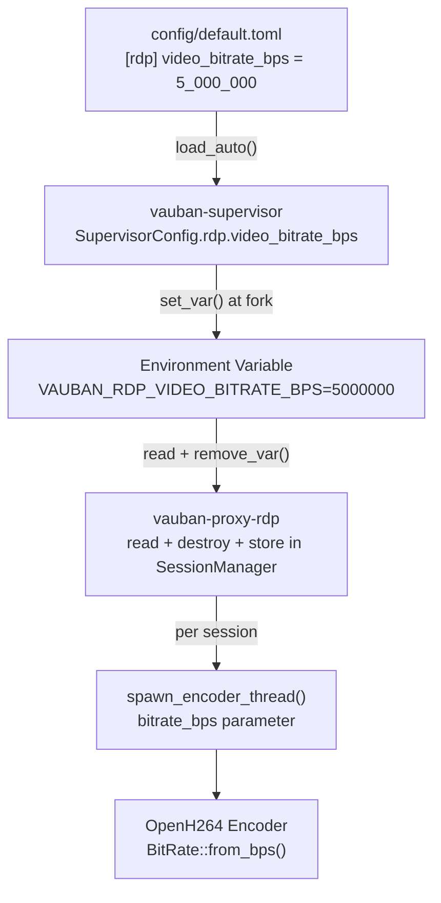

---

## Appendix B: Error Handling

| Error | Layer | Handling |
|-------|-------|----------|
| DNS resolution failure | Supervisor | `TcpConnectResponse(success=false)` |
| TCP connection refused | Supervisor | `TcpConnectResponse(success=false)` |
| RDP authentication failure (NLA) | Proxy | `RdpSessionOpenFailed(reason)`, see 11.3.1 |
| Any other open failure | Proxy | `RdpSessionOpened(success=false, error=code)` |
| Session disconnected | Proxy | Session cleanup, WebSocket close |
| H.264 encoder failure | Proxy | Log error, encoder thread exits |
| WebSocket disconnected | Web | Session cleanup, `RdpSessionClose` sent to proxy |
| IPC pipe broken | Supervisor | Linked group restart (Web + ProxyRdp) |

### B.1 Open failure codes (0.9.51)

The `error` field of `RdpSessionOpened` and `RdpServerCertResult` is a
string on the wire and only ever holds one of the codes below
(`shared::messages::RdpOpenFailure`). The text of the underlying error
can quote the target or the TLS stack: it stays in the
`vauban-proxy-rdp` log, in its Debug form, keyed by session id.

| Code | Meaning |
|------|---------|
| `access_denied` | The proxy's own access check refused the session |
| `draining` | The proxy is restarting and takes no new session |
| `no_pinned_certificate` | The asset has no pinned server certificate |
| `credentials_unavailable` | The proxy could not obtain the target's credentials |
| `server_certificate_mismatch` | The target presented a certificate other than the pinned one |
| `tls_failed` | The TLS handshake failed for another reason |
| `connection_failed` | The connection to the target failed or was lost |
| `session_failed` | The RDP exchange failed after the transport was up |
| `internal` | Anything else |

vauban-web turns a code into a constant sentence
(`services::rdp_open_failure`). A value that is not a code, for example
the text an older proxy would send, is read as `internal` and is never
shown. Failures of the web tier itself (supervisor connect, IPC) are
answered with a constant sentence as well.

---
