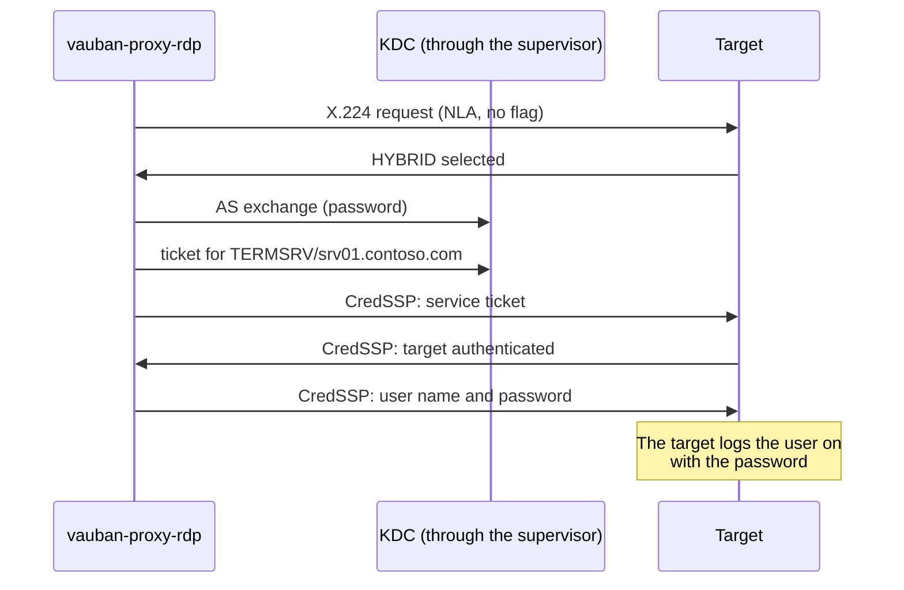
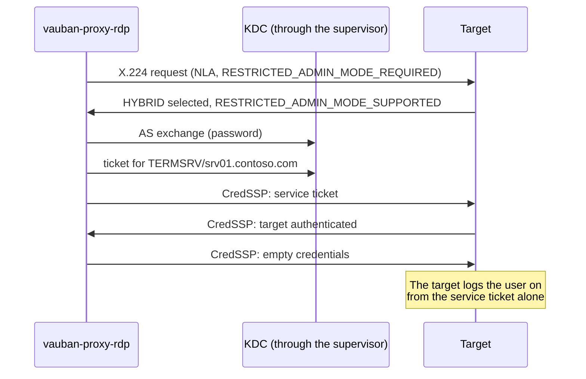
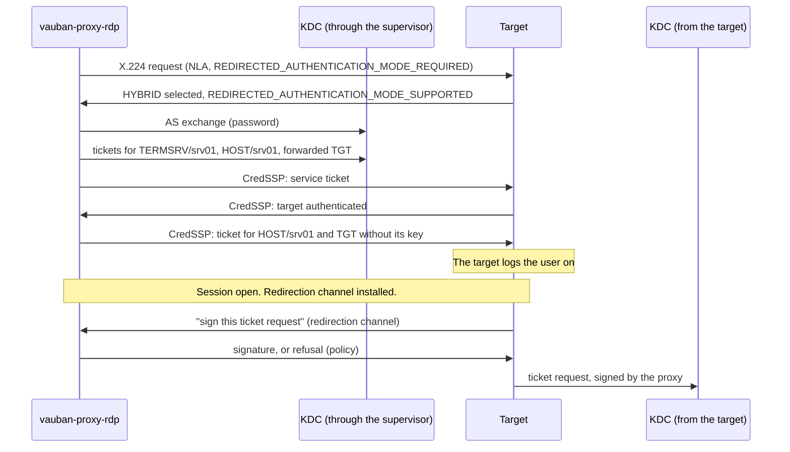
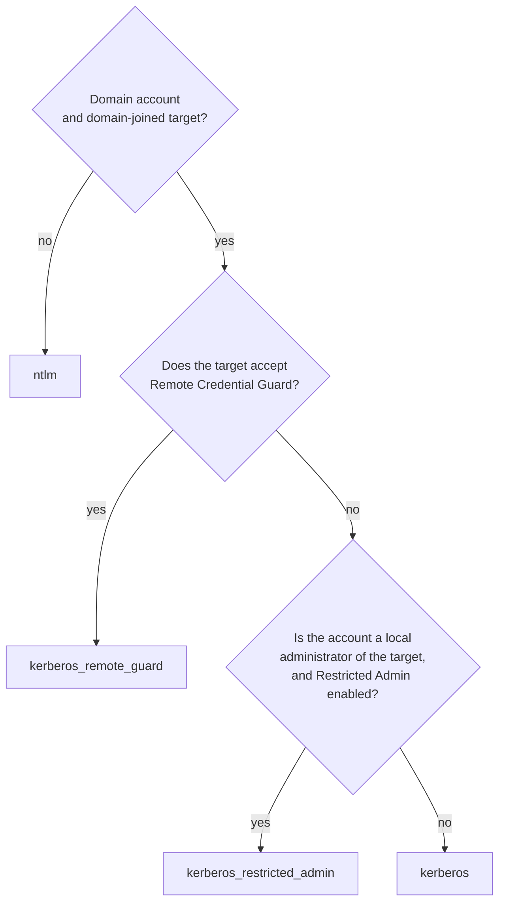

# Vauban RDP Kerberos Authentication Modes

**Version:** 1.0  
**Date:** 21 November 2026  
**Author:** Richard Ben Aleya  
**Applies to:** crate **0.9.61**

---

## Table of Contents

1. [Purpose](#1-purpose)
2. [The three modes at a glance](#2-the-three-modes-at-a-glance)
3. [What the three modes share](#3-what-the-three-modes-share)
4. [Kerberos (`kerberos`)](#4-kerberos-kerberos)
5. [Kerberos Restricted Admin (`kerberos_restricted_admin`)](#5-kerberos-restricted-admin-kerberos_restricted_admin)
6. [Kerberos Remote Credential Guard (`kerberos_remote_guard`)](#6-kerberos-remote-credential-guard-kerberos_remote_guard)
7. [Choosing a mode](#7-choosing-a-mode)
8. [Configuration reference](#8-configuration-reference)
9. [Failure reasons](#9-failure-reasons)
10. [Threat model](#10-threat-model)
11. [Code map and tests](#11-code-map-and-tests)
12. [Known limits](#12-known-limits)

---

## 1. Purpose

An RDP asset is opened with one of four Network Level Authentication
modes: `ntlm` and three Kerberos modes. This document describes the
three Kerberos modes: what each one sends to the target, what the
session can do on the network afterwards, what the target and the
domain must provide, and how to choose between them.

The mechanics shared with the rest of the RDP proxy (sandbox, KDC
socket brokering, failure classification, TLS pinning) are specified in
[Vauban RDP Session Architecture](Vauban_RDP_Architecture_EN(1.0).md),
§11.3.1. This document does not repeat them; it refers to them.

The names used in the examples are placeholders: `srv01.contoso.com`
(target), `contoso.com` (domain), `CONTOSO.COM` (realm), `jdoe`
(account).

## 2. The three modes at a glance

| | `kerberos` | `kerberos_restricted_admin` | `kerberos_remote_guard` |
|---|---|---|---|
| Label in the interface | Kerberos | Kerberos RA | Kerberos RCG |
| Who can log on | any domain account with the Remote Desktop logon right | local administrators of the target only | any domain account with the Remote Desktop logon right |
| X.224 flag requested | none | `RESTRICTED_ADMIN_MODE_REQUIRED` | `REDIRECTED_AUTHENTICATION_MODE_REQUIRED` |
| What the target receives in CredSSP | the user name and the password | nothing (empty credentials) | a ticket for the target and a TGT **without its key** |
| Password reaches the target | yes | no | no |
| Reusable secret left on the target | yes: the password | no | no |
| Identity of the session on the network | the user | the computer account of the target | none (`deny`, default) or the user, through the bastion (`allow`) |
| Kerberos secret kept by the proxy during the session | none | none | the key of the user's TGT |
| Target prerequisite | joined to the domain | `DisableRestrictedAdmin = 0`, account in the local Administrators group | Remote Credential Guard accepted by the target |

`ntlm` is the fourth mode, for local accounts and for hosts outside a
domain. `[rdp] ntlm_policy = "deny"` turns it off for the whole
bastion: only assets in one of the three Kerberos modes are then
opened.

## 3. What the three modes share

**Kerberos only, no fallback.** The SPNEGO package list is `kerberos`
alone. A target that selects NTLM fails the CredSSP sequence; the
proxy emits no NTLM token.

**NLA is mandatory.** The X.224 negotiation is cleartext and precedes
TLS. The proxy refuses to continue unless the target selected `HYBRID`
or `HYBRID_EX` and, for the two modes that request a flag, announced
the matching `..._SUPPORTED` flag in its answer. The refusal happens
before the TLS upgrade and before any credential or ticket is sent
(reason `negotiation_refused`).

**The asset needs a name and a domain.** A Kerberos mode requires a
fully-qualified DNS hostname (the name becomes the service principal
name; an IP address is refused in every form) and the DNS name of the
domain.

**The KDC is reached through the supervisor.** The proxy is sandboxed
and cannot open a connection. For each Kerberos exchange it asks the
supervisor for a connected socket, by realm; the supervisor connects
only to the KDC hosts configured for that realm under
`[auth.kerberos]`. The proxy never looks a KDC up through DNS.

**The target certificate is pinned.** As in `ntlm`, the TLS
certificate of the target is checked against the fingerprint stored on
the asset.

**One table defines the modes.** `auth_mode_profile` in
`vauban-proxy-rdp/src/session.rs` holds one value per mode: what the
target receives (`TargetCredentials`: the password, nothing, or Remote
Credential Guard credentials). The negotiation flag, the flag expected
back, the CredSSP mode and the fate of the password in the Client Info
PDU are computed from that value, so they cannot disagree.

## 4. Kerberos (`kerberos`)

### 4.1 What happens



The target is authenticated by a service ticket and no NTLM response
crosses the network. The password is then delegated to the target
inside CredSSP, encrypted for the target, exactly as in `ntlm`. The
Client Info PDU that follows also carries it.

### 4.2 Consequences

- The session has the full identity of the user on the network: file
  shares, other servers, single sign-on from inside the session all
  work.
- The target holds the password for the lifetime of the logon session.
  A compromised target can read it and reuse it, anywhere, after the
  session ends.

### 4.3 Prerequisites

- The target is joined to the domain and registered under the asset
  hostname (`setspn -Q TERMSRV/srv01.contoso.com`).
- The account may log on through Remote Desktop.

### 4.4 When to use it

For domain accounts on targets that accept neither of the two other
modes, when the target is trusted with the password. It is the
Kerberos mode with the widest compatibility and the weakest protection
of the credential.

## 5. Kerberos Restricted Admin (`kerberos_restricted_admin`)

### 5.1 What happens



The target receives no credential: the logon rests on the service
ticket. The proxy removes the password from the connector
configuration as soon as the CredSSP client has taken its own copy
(`strip_client_info_password`), so the Client Info PDU carries no
password either.

### 5.2 Consequences

- Nothing reusable reaches the target: no password, no TGT.
- From inside the session, network access is performed as the
  **computer account of the target**, not as the user. The user cannot
  reach, as themselves, a share or a server from the session.
- Only members of the local Administrators group of the target can log
  on this way. This is a rule of Windows, not of the bastion.

### 5.3 Prerequisites

- The target is joined to the domain and registered under the asset
  hostname.
- Restricted Admin is enabled on the target: `DisableRestrictedAdmin`
  is `0` under `HKLM\SYSTEM\CurrentControlSet\Control\Lsa`.
- The account is a local administrator of the target.

### 5.4 When to use it

For administration accounts, on targets where the administrator works
on the machine itself and needs no personal identity on the network
from it.

## 6. Kerberos Remote Credential Guard (`kerberos_remote_guard`)

### 6.1 What happens



Instead of a password the target receives `TSRemoteGuardCreds`: a
ticket for its own computer account (`HOST/<fqdn>`) and a forwarded
TGT of the user whose session key is replaced by a handle. **The key
stays in the proxy.**

A TGT without its key is useless on its own. Each time the target
needs Kerberos for the user (to obtain a service ticket, or to use
one), it asks the proxy, over a dynamic virtual channel of the RDP
session (`Microsoft::Windows::RDS::AuthRedirection`, [MS-RDPEAR]), to
perform the operation that needs the key. The target talks to the KDC
itself; the proxy only computes. The supervisor's KDC broker is not
used after the logon.

The proxy drives this mode itself: it sets the flag, checks the
answer, runs CredSSP in `CredSspMode::RemoteGuard`, and once the
target has accepted the logon it installs the channel
(`attach_remote_guard_channel`). No other mode installs that channel.

### 6.2 Outbound identity: the bastion decides

What the proxy answers on the channel is a bastion-wide setting,
`[rdp] remote_guard_outbound_identity`:

| Value | The proxy | From the session, the user |
|---|---|---|
| `"deny"` (default) | answers the version negotiation the logon needs, and refuses every other operation | has no identity on the network: no service ticket is obtained, and a ticket already held cannot be used, because each use needs a signature from the proxy |
| `"allow"` | performs the operations | reaches other services as themselves, for as long as the session is open |

Under `deny` the session opens normally and the desktop works; only
access to other machines as the user is closed. A Windows target keeps
asking, about once per second; the proxy answers each request and logs
the first refusal of a session, then a count every five minutes.

The setting follows the model of `ntlm_policy`: a closed set read
exactly, where a value outside it stops the supervisor and vauban-web
at load. The supervisor hands it to the RDP proxy alone, in an
environment variable the proxy reads once and removes. A change takes
effect when the proxy restarts; a session keeps the value it was
opened with. vauban-web shows the value, read-only, on the asset
forms, and decides nothing with it.

A third value, `"services"`, with a list of services the target may
reach (`remote_guard_allowed_services = ["cifs", "ldap"]`), is planned.
It is refused until it is implemented.

**Redirected NTLM is never granted**, under either value: no Kerberos
mode reaches NTLM. The target receives no NTLM credential and every
NTLM request on the channel is refused. A resource reached by IP
address from such a session is therefore not accessible, whatever the
setting.

### 6.3 What is logged

- At the logon: the value of the setting.
- Under `allow`: each ticket the target requests and each ticket it
  obtains, with the service name and the session identifier.
- Under `deny`: the first refusal, then a periodic count.

A service name is chosen by the target or relayed by the KDC: it is
reduced to printable ASCII, bounded in length, and written on a single
line. No other argument of a request is logged: they are keys, or are
encrypted with one.

### 6.4 Request-loop guard

A target whose Kerberos module does not accept the proxy's responses
asks for the same operations without end and never brings back a KDC
reply. Under `allow`, the proxy counts the ticket requests it answered
since the last KDC reply the target brought back; at 240 within 60
seconds it logs the cause, closes the channel (the keys are erased)
and the session ends. A working logon is a few tens of operations.

### 6.5 Prerequisites

- The target is joined to the domain. The asset hostname is the name
  under which its **computer account** is registered
  (`setspn -Q HOST/srv01.contoso.com`): the mode requests a ticket for
  `HOST/<fqdn>` in addition to `TERMSRV/<fqdn>`.
- The target accepts Remote Credential Guard: the policy "Remote host
  allows delegation of non-exportable credentials", or
  `DisableRestrictedAdmin = 0` under
  `HKLM\SYSTEM\CurrentControlSet\Control\Lsa`.
- The account may log on through Remote Desktop. It does not need to
  be a local administrator.

### 6.6 When to use it

For any domain account when the target must not receive the password.
With `deny`, it gives a session confined to the target. With `allow`,
it gives the user their network identity without handing the target
anything that outlives the session.

## 7. Choosing a mode



| Need | Mode |
|---|---|
| Keep the password off the target, any account | `kerberos_remote_guard` |
| Keep the password off the target, session confined to the target | `kerberos_remote_guard` with `"deny"` |
| Keep the password off the target, user reaches shares as themselves | `kerberos_remote_guard` with `"allow"` |
| Administrator working on the machine only | `kerberos_restricted_admin` or `kerberos_remote_guard` |
| Target that supports neither protection | `kerberos` |
| Local account, or host outside a domain | `ntlm` |

## 8. Configuration reference

### 8.1 Bastion (`vauban.conf`)

```toml
[auth.kerberos]
enabled = true
realm = "CONTOSO.COM"
kdc_host = "dc01.contoso.com"
kdc_port = 88

[rdp]
# "allow" (default) or "deny". "deny" opens only assets in a Kerberos mode.
ntlm_policy = "allow"
# "deny" (default) or "allow". Remote Credential Guard sessions only.
remote_guard_outbound_identity = "deny"
```

Several realms, and several KDC hosts per realm, are declared with
`[[auth.kerberos.realms]]`. A value outside the closed set of either
`[rdp]` key stops the supervisor and vauban-web at startup; it is
never read as the permissive value.

### 8.2 Asset

The mode and the domain are set on the asset form, or through the API:

```json
{
  "name": "srv01",
  "hostname": "srv01.contoso.com",
  "asset_type": "rdp",
  "rdp_auth_mode": "kerberos_remote_guard",
  "rdp_domain": "contoso.com"
}
```

`rdp_auth_mode` is one of `ntlm`, `kerberos`,
`kerberos_restricted_admin`, `kerberos_remote_guard`. Any other value
is refused; it is never stored as `ntlm`.

## 9. Failure reasons

A refused session carries a reason from a closed set, shown with its
remedy to a holder of `assets:manage`. The full table is in the RDP
architecture document, §11.3.1. The reasons specific to a mode:

| Reason | Mode | Meaning | Check |
|---|---|---|---|
| `negotiation_refused` | all | the target did not negotiate NLA, or did not announce the flag of the mode | NLA on the target; support of Restricted Admin or Remote Credential Guard |
| `credentials_rejected` | `kerberos` | the target refused the logon | credentials, Remote Desktop logon right |
| `restricted_admin_refused` | `kerberos_restricted_admin` | the target refused the logon | `DisableRestrictedAdmin = 0`, local administrator |
| `remote_guard_refused` | `kerberos_remote_guard` | the target refused the logon; the KDC had accepted the password | Remote Desktop logon right, Remote Credential Guard accepted by the target, `setspn -Q HOST/<fqdn>` |
| `service_principal_unknown` | all | the KDC knows no such service | asset FQDN; `TERMSRV/<fqdn>`, and `HOST/<fqdn>` for Remote Credential Guard |
| `ntlm_forbidden` | `ntlm` | `ntlm_policy = "deny"` | switch the asset to a Kerberos mode |

The reasons that come from the KDC (`pre_auth_failed`, `clock_skew`,
`client_principal_unknown`, and the others) are the same in the three
modes: the exchange with the KDC starts the same way.

A Remote Credential Guard session that ends after it opened (a
protection error on the channel, or the request-loop guard) is logged
with its cause in the `vauban-proxy-rdp` log. It is not yet reported
in the interface.

## 10. Threat model

| Question | `kerberos` | `kerberos_restricted_admin` | `kerberos_remote_guard` |
|---|---|---|---|
| A compromised target learns the password | yes | no | no |
| A compromised target can act as the user after the session | yes | no | no |
| A compromised target can act as the user during the session | yes | no | no under `deny`; yes under `allow`, through the bastion |
| The bastion holds a Kerberos secret while the session is open | no | no | yes: the key of the user's TGT |
| The bastion sees which services the user reaches from the target | no | no | yes under `allow` (logged) |

Points specific to Remote Credential Guard:

- The proxy keeps the key of the user's TGT for the whole session, in
  the sandboxed `vauban-proxy-rdp` process. In every other mode it
  holds no Kerberos secret once the session is open.
- Under `allow`, the bastion is the one that signs. A compromised
  target can ask it to sign for any service the user may reach, for as
  long as the session is open, and obtains nothing it can use
  afterwards.
- Every message on the channel is untrusted input: bounded in size,
  decoded strictly; any protection error closes the channel and erases
  the keys.
- The policy is enforced in the proxy, from a value the supervisor
  provides. vauban-web cannot change it for a session.

## 11. Code map and tests

| Subject | Where |
|---|---|
| The modes, their wire names | `shared/src/messages.rs` (`RdpAuthMode`) |
| What each mode means on the wire | `vauban-proxy-rdp/src/session.rs` (`auth_mode_profile`) |
| Negotiation check, CredSSP, channel installation | `vauban-proxy-rdp/src/session.rs` (`check_negotiation`, `perform_credssp_step`, `attach_remote_guard_channel`) |
| Outbound-identity policy, logging, loop guard | `vauban-proxy-rdp/src/remote_guard.rs` |
| Redirection channel backend | `vauban-proxy-rdp/src/remote_guard_channel.rs` |
| Failure classification | `vauban-proxy-rdp/src/auth_failure.rs` |
| Configuration keys | `vauban-supervisor/src/config.rs`, `vauban-web/src/config.rs` |
| Validation of the mode on an asset | `vauban-web/src/services/rdp_auth_mode.rs` |

The redirection channel backend is adapted from a private module of
the IronRDP connector. It sets the ASN.1 slot of each Kerberos
response (`KERB_ASN1_DATA.Pdu`), which a Windows target requires and
the upstream module leaves at 0. It is compared with the upstream
module on every bump of the IronRDP pin.

No domain controller is available in CI. The three modes are covered
by an in-process harness (`session::credssp_loop_tests`): the
production CredSSP function runs against an in-memory KDC and an
in-memory target. The outbound-identity policy is tested through the
real channel backend, behind a scripted Kerberos session
(`remote_guard_tests.rs`). Structural invariants
(`tests/auth_mode_profile_invariants_test.rs`) keep the modes, the
policy and the channel installation consistent.

What CI cannot cover is a Windows target accepting the logon and using
the channel. That is the object of two manual checklists:

- [IronRDP upgrade smoke test](../runbooks/ironrdp_migration_smoke_test.md):
  `kerberos` and `kerberos_restricted_admin`.
- [Remote Credential Guard smoke test](../runbooks/rdp_remote_credential_guard_smoke_test.md):
  `kerberos_remote_guard`, under `deny` and under `allow`.

## 12. Known limits

- **Remote Credential Guard and newer Windows versions.** The ASN.1
  slot values are those of Windows versions up to Server 2022, with a
  shifted value for newer Kerberos modules taken from the FreeRDP
  `rdpear` channel. The shifted value has not been checked against a
  target that needs it. A target that needs a value the proxy does not
  send is the case the request-loop guard closes.
- **Mid-session closures are logged, not shown.** See §9.
- **No per-service policy yet.** `"services"` is planned (§6.2).
- **No redirected NTLM**, by design (§6.2).
- **Restricted Admin is for local administrators only**, by design of
  Windows (§5.2).
