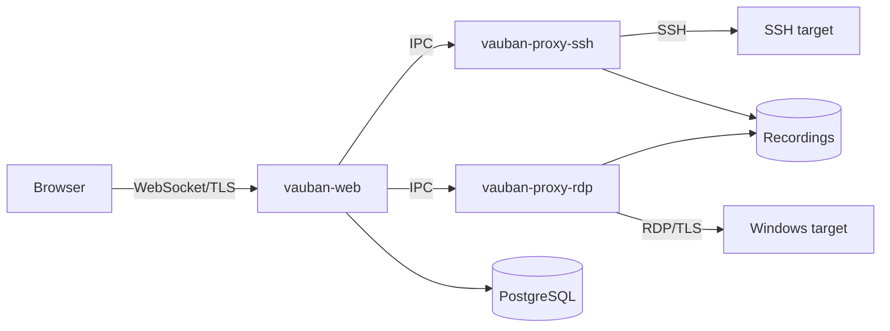

# Capacity planning guide — Vauban

> For architects and operators who size a Vauban host: CPU, memory, network, SSD.  
> Date: 2026-11-22 — applies to Vauban 0.9.61 and later.  
> Related: [`../technical/Vauban_RDP_Architecture_EN(1.0).md`](../technical/Vauban_RDP_Architecture_EN(1.0).md), [`../technical/Vauban_Recording_Architecture_EN(1.9).md`](../technical/Vauban_Recording_Architecture_EN(1.9).md)

---

## How to read this note

Every figure carries one of three labels. Do not treat them as equivalent.

| Label | Meaning |
|-------|---------|
| **Measured** | Observed on the reference host, with the method stated |
| **Derived** | Computed from measured figures or from constants in the code |
| **Estimate** | Reasoned from the design; no measurement backs it yet |

The measurements come from **single sessions and an isolated encoder benchmark**. No multi-session load test has been run. Treat the sizing tables as a starting point and validate them with the procedure in [Refining these figures](#refining-these-figures) before committing to hardware.

### Reference host

| Item | Value |
|------|-------|
| CPU | Intel Xeon E-2246G (6 cores / 12 threads, 3.6 GHz base, AVX2) |
| Memory | 32 GB |
| Storage | Datacenter NVMe SSD |
| OS | FreeBSD 15.1 (amd64) |

A **reference core** below means one physical core of this CPU. A current server core (AMD Zen 4/5, Intel Sapphire Rapids or later) is worth roughly 1.3 to 1.5 reference cores under full load (**Estimate**).

---

## What drives the load



| Session type | Dominant cost | Why |
|--------------|---------------|-----|
| **RDP** | CPU, then memory | Each session re-encodes the remote screen to H.264 in software, on a dedicated thread |
| **SSH** | Storage | Terminal bytes are relayed and written to the recording; CPU and memory per session are small |

RDP cost depends on **how much the screen moves**, not on how many sessions are open. A session showing a static screen encodes nothing. This is why the concurrency assumption matters more than the user count.

---

## RDP sessions

### CPU

**Cost per encoded frame**, isolated benchmark, encoder settings identical to Vauban's, 300 frames, 6 interleaved runs, one pinned core, run-to-run spread under 0.5 % (**Measured**, synthetic desktop content):

| Content (1280x720) | Framebuffer copy | Color conversion | H.264 encode | Total |
|--------------------|------------------|------------------|--------------|-------|
| Typing in a text window | 0.3 ms | 0.5 ms | 4.7 ms | 5.5 ms |
| Dragging a window | 0.3 ms | 0.5 ms | 6.9 ms | 7.7 ms |
| Scrolling text | 0.3 ms | 0.5 ms | 10.7 ms | 11.5 ms |
| Video region (640x360) | 0.3 ms | 0.5 ms | 2.7 ms | 3.5 ms |
| Scrolling text at 1920x1080 | 1.0 ms | 1.2 ms | 20.5 ms | 22.7 ms |

Vauban encodes at most 60 frames per second, so the per-frame budget is 16.7 ms. At 1920x1080, sustained scrolling exceeds it: the frame rate drops, the session stays up.

**CPU per live session**, sampled every 5 s on a real 1280x720 session (**Measured**, one session, one operator):

| Screen activity | `vauban-proxy-rdp` CPU (reference cores) |
|-----------------|------------------------------------------|
| Static screen | 0.00 – 0.03 |
| Light (typing, clicking) | 0.04 – 0.19 |
| Sustained motion | 0.28 – 0.73 |
| Peak observed | 1.07 |

About three quarters of that is the encoder thread; the rest is RDP decoding and relaying. Over 8.5 minutes of deliberately active test sessions the average was 0.32 reference core (**Measured**).

`vauban-web` adds at most 15 % on top (**Derived**: 22 s of CPU against 164 s for the proxy over the same sessions; an upper bound, since the web process was doing other work too).

**Planning figures** (reference cores per concurrent session, 1280x720, including `vauban-web`):

| Profile | Assumption | Per session |
|---------|------------|-------------|
| Administration | Mostly static screens, short bursts | **0.25** |
| Active | Every session in sustained motion at once | **0.80** |
| Peak | Every session at the observed peak at once | **1.25** |

For other resolutions, scale by pixel count: x2.25 for 1920x1080, x4 for 2560x1440 (**Derived**; the 1080p scrolling measurement gives x2.0).

What does **not** change the CPU cost (**Measured**): encoder complexity level, encoder thread count, scene-change detection. The encoder runs single-threaded per session.

### Memory

| Component | 1280x720 | 1920x1080 | 2560x1440 | 3840x2160 | Label |
|-----------|----------|-----------|-----------|-----------|-------|
| Encoder, one frame copy, YUV buffer | 34 MB | 63 MB | 104 MB | 217 MB | Measured (benchmark) |
| Session framebuffer (width x height x 4) | 3.7 MB | 8.3 MB | 14.7 MB | 33 MB | Derived |
| Up to two queued frame copies | 7.4 MB | 16.6 MB | 29.5 MB | 66 MB | Derived |
| **Floor per session** | **45 MB** | **88 MB** | **148 MB** | **316 MB** | Derived |

The floor excludes RDP protocol state and the recording buffer, which holds encoded frames until the next keyframe.

On the reference host the `vauban-proxy-rdp` process sat at about 320 MB after two short 1280x720 sessions, against 11 MB for an idle proxy (**Measured**). That is well above the floor and not yet explained. Until a multi-session measurement narrows it down, plan with:

| Resolution | Planning figure per concurrent session |
|------------|----------------------------------------|
| 1280x720 | **300 MB** |
| 1920x1080 | **700 MB** |

### Network

Bandwidth from Vauban to the browser, per session:

| Situation | Bit rate | Label |
|-----------|----------|-------|
| Static screen | ~0 | Measured |
| Average over 131 recorded sessions (8.2 h, test usage) | 0.03 Mbit/s | Measured |
| Active test session | 0.5 – 0.6 Mbit/s | Measured |
| Continuous motion | 0.7 – 7 Mbit/s | Measured (benchmark) |

`[rdp] video_bitrate_bps` (default 5,000,000) is a **target, not a hard cap**: scrolling text reached 7.1 Mbit/s against the 5 Mbit/s target, because the encoder is not allowed to skip frames.

Plan **0.5 Mbit/s average and 7 Mbit/s peak per concurrent session**. Traffic between Vauban and the Windows target has not been measured; assume the same order of magnitude.

### Recording storage

The recording is the encoded H.264 stream itself (fragmented MP4, no re-encoding, no compression), so it grows at the bit rate above.

| Situation | Growth | Label |
|-----------|--------|-------|
| Median session (70 sessions of 60 s or more) | 9 MB/h | Measured |
| 90th percentile | 26 MB/h | Measured |
| Mean over all recorded time | 14 MB/h | Measured |
| Highest recorded session | 434 MB/h | Measured |
| Active test session | 250 – 270 MB/h | Measured |
| Continuous scrolling, worst case | 3.2 GB/h | Derived from benchmark |

Plan **25 MB per session-hour** for administration work and **250 MB per session-hour** for sustained activity.

---

## SSH sessions

CPU and memory were sampled every 5 s on two live sessions opened one after the other (**Measured**, one operator). Storage figures come from recorded sessions.

### CPU

An SSH session costs CPU only when bytes flow. Each chunk of terminal output is decrypted, written to the recording (JSON line plus BLAKE3), passed to `vauban-web` over IPC, and sent to the browser as one WebSocket frame. There is no batching and no rate limit, so the cost follows the **number of output events**, not the byte count.

| Situation | `vauban-proxy-ssh` | `vauban-web` | Label |
|-----------|--------------------|--------------|-------|
| Idle shell | 0.000 | 0.000 – 0.001 | Measured |
| Interactive work | 0.001 – 0.002 | 0.002 – 0.006 | Measured |
| Output burst (12,400 events in one 5 s window) | 0.115 | 0.095 | Measured |

The burst cost about 85 microseconds of CPU per output event across both processes (**Derived**: 1.05 s of CPU for 12,400 events). At the 75 events per second averaged over recorded sessions (**Measured**: 274,000 events per session-hour), that is 0.006 reference core per session (**Derived**).

A session that streams output continuously costs at least 0.2 reference core while it lasts; the ceiling for faster output was not measured.

Plan **0.01 reference core per concurrent session**.

### Memory

| Component | Value | Label |
|-----------|-------|-------|
| `vauban-proxy-ssh`, idle | 11.7 MB | Measured |
| Growth per session in `vauban-proxy-ssh` | 0.4 – 0.8 MB | Measured (two sessions) |
| Growth per session in `vauban-web` | 0.6 – 1.0 MB | Measured (two sessions) |

No scrollback is kept server-side. Plan **5 MB per concurrent session**: about three times the measured growth, to cover transport buffers that fill when a browser reads slowly.

### Network

Tens of kbit/s per interactive session (**Derived** from the recording growth below). SSH traffic is negligible next to RDP unless sessions stream large outputs.

### Recording storage

Recordings are asciicast v2 text, uncompressed, about 104 bytes per event (**Measured**).

| Situation | Growth | Label |
|-----------|--------|-------|
| Median session (14 sessions of 60 s or more) | 7 MB/h | Measured |
| 90th percentile | 52 MB/h | Measured |
| Mean over all recorded time (1.2 h) | 27 MB/h | Measured |
| Highest recorded session | 62 MB/h | Measured |

The sample is small and comes from test usage with heavy output. Plan **25 MB per session-hour**. A session that prints large files grows the recording at the output rate; there is no per-session size limit.

---

## Fixed costs

| Item | Value | Label |
|------|-------|-------|
| All Vauban processes, idle | ~200 MB | Measured |
| PostgreSQL connections at steady state | 26 (20 web, 4 access, 2 mailer) | Derived from code, matches observation |
| PostgreSQL memory | Plan 1 GB | Estimate |
| Database size after ~1,300 sessions | 13 MB (about 1 kB per session) | Measured |
| Row growth during a session | None | Derived from code |

The database is not a sizing factor at these scales.

---

## Sizing method

```text
CPU cores  = (RDP sessions x RDP profile x resolution factor
              + SSH sessions x 0.01) / 0.75
Memory     = 2 GB + RDP sessions x per-session figure + SSH sessions x 5 MB
Bandwidth  = RDP sessions x 0.5 Mbit/s average, x 7 Mbit/s for the peak
Storage    = session-hours per day x MB per session-hour x retention days
```

The 0.75 divisor keeps 25 % CPU headroom. Results are in reference cores; divide by 1.3 to 1.5 for current server CPUs.

**Concurrent** sessions means sessions open at the same instant, not registered users.

### Worked examples (1280x720)

| Concurrent sessions | CPU, administration profile | CPU, active profile | Memory | Average / peak bandwidth |
|---------------------|-----------------------------|---------------------|--------|--------------------------|
| 25 RDP | 9 ref. cores | 27 ref. cores | 10 GB | 13 / 175 Mbit/s |
| 100 RDP | 34 ref. cores | 107 ref. cores | 32 GB | 50 / 700 Mbit/s |
| 250 RDP | 84 ref. cores | 267 ref. cores | 77 GB | 125 / 1,750 Mbit/s |
| 100 SSH | 2 ref. cores | — | 2.5 GB | negligible |
| 1,000 SSH | 14 ref. cores | — | 7 GB | under 100 Mbit/s |

On the reference host itself (about 5 reference cores available to RDP after headroom), this gives roughly **20 concurrent RDP sessions in the administration profile, or 6 in the active profile**.

### Storage example

100 users, 4 session-hours each per working day, 220 working days, default one-year retention:

| Type | Rate | Per year |
|------|------|----------|
| RDP, administration | 25 MB/h | 2.2 TB |
| RDP, active | 250 MB/h | 22 TB |
| SSH | 25 MB/h | 2.2 TB |

---

## SSD requirements

| Aspect | Requirement | Why |
|--------|-------------|-----|
| Durability | Power-loss protection | Every active recording is flushed with `fdatasync` once per second; every audit record is `fsync`ed |
| Write rate | Up to one sync per second per active recording | Modest for any datacenter NVMe drive |
| Endurance | Size from the yearly volume above | Recordings are written once and never rewritten |
| Capacity | Yearly volume plus 30 % | Retention is enforced by a daily job, in batches |

The audit log is append-only and never deleted; at a few hundred bytes per record it stays small.

---

## Settings that change the plan

| Setting (`config/vauban.conf`) | Default | Effect |
|--------------------------------|---------|--------|
| `[rdp] video_bitrate_bps` | 5,000,000 | Bandwidth and RDP recording size; a target, not a cap |
| `[security] max_concurrent_sessions_per_user` | 10 | Upper bound on concurrency per user |
| `[security] max_concurrent_sessions_per_asset` | 20 | Upper bound on concurrency per target |
| `[security] session_max_duration_secs` | 14,400 | Longest session, hence largest recording |
| `[security] session_idle_timeout_secs` | 900 | Closes idle sessions |
| `[database] max_connections` | 20 | PostgreSQL connections held by `vauban-web` |
| `[recording] retention_days` | 365 | Storage volume |
| `[recording] retention_max_size_gib` | 0 (unlimited) | Hard ceiling on recording storage when set |

Not configurable today: the 60 frames-per-second ceiling, the RDP session resolution (set by the browser window), and any global cap on concurrent sessions.

---

## Behavior under overload

- **RDP, CPU saturated:** frames are skipped while the encoder is busy. The frame rate drops; sessions are not disconnected.
- **SSH, slow consumer:** queues between the proxy, `vauban-web`, and the browser are bounded, so a slow reader applies backpressure upstream.
- **Storage full:** recording writes fail. Set `retention_max_size_gib` and monitor free space.

---

## Refining these figures

Run this on your own hardware before you commit to a size.

1. Open N identical sessions (start with 5, then 10, 20) and replay the same activity in each.
2. Sample per-process CPU and resident memory every 5 seconds for `vauban-proxy-rdp`, `vauban-proxy-ssh`, and `vauban-web`.
3. Read the `H.264 perf metrics` log lines: `avg_encode_ms` and `encode_fps` show whether the 60 fps ceiling is held.
4. Check that cost per session stays constant as N grows. If it rises, the limit is contention, not core count.
5. After a representative week, compute real recording rates:

```sql
SELECT recording_format,
       count(*)                                             AS sessions,
       sum(recording_size_bytes) / 1048576.0
         / (sum(recording_duration_ms) / 3.6e6)             AS mb_per_hour
FROM proxy_sessions
WHERE recording_duration_ms > 0 AND recording_size_bytes > 0
GROUP BY recording_format;
```

### Known gaps

| Gap | Impact |
|-----|--------|
| No multi-session load test | Linear scaling is assumed, not shown |
| RDP memory above the computed floor is unexplained | Memory figures are deliberately conservative |
| SSH measured on two sessions only | Validate before sizing an SSH-heavy deployment |
| Traffic to targets not measured | Network figures cover the browser side only |
| Benchmark content is synthetic | Real desktops may cost more or less per frame |
| One resolution observed live (1280x720) | Other resolutions are scaled by pixel count |
