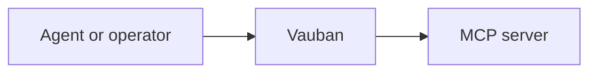
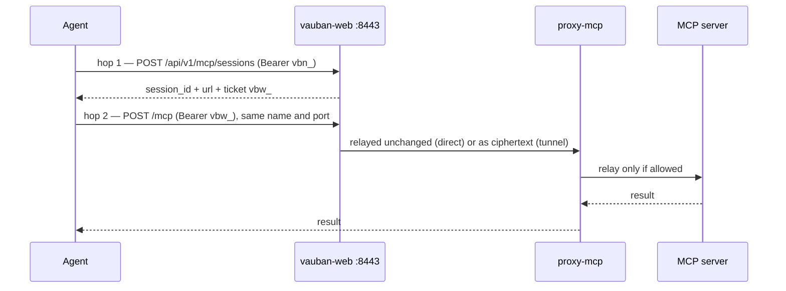
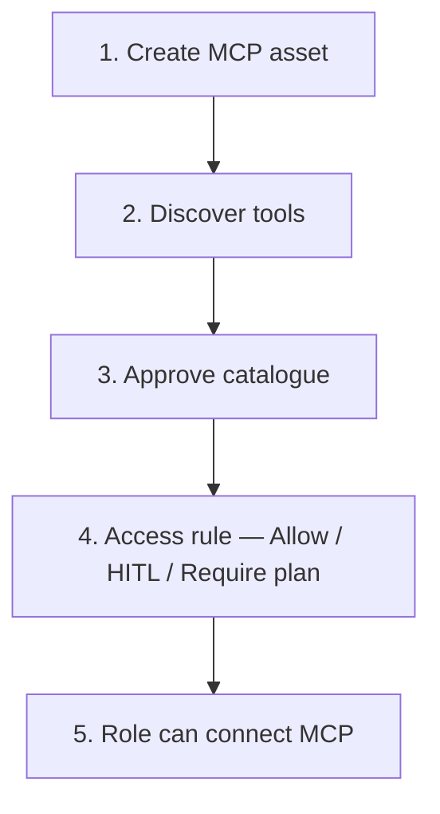
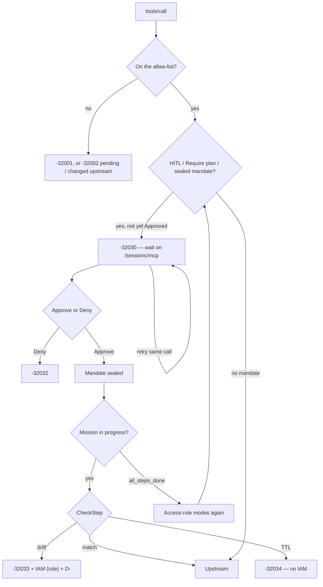
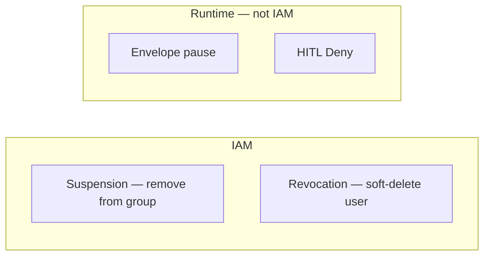

# User guide — MCP in Vauban

> For administrators and operators who use the UI.  
> Date: 2026-10-10  
> Architecture (hops, Mission Seal, agent view): [`../technical/Vauban_MCP_Architecture_EN(1.0).md`](../technical/Vauban_MCP_Architecture_EN(1.0).md)  
> Authorization choice: [`../adr/009-mcp-no-oauth-for-now.md`](../adr/009-mcp-no-oauth-for-now.md)

---

## What it is

Vauban protects **MCP tool servers** the same way it already protects SSH, RDP, and industrial assets: **who**, **which tools**, **how long**, **what is recorded**.

The agent (or a human via Connect) never talks to the tool server directly.



Without Vauban, the agent calls the server directly — no PAM control.

---

## Words you will see

| Term | Meaning |
|------|---------|
| **MCP asset** | The tool-server record (host, port, secret) |
| **Access rule** | Who may use which asset, with which tools |
| **API key `vbn_…`** | Machine identity. Used only to **open** a session |
| **Ticket `vbw_…`** | Short-lived bearer for the **proxy** during the visit |
| **Catalogue / TOFU** | Discover tools → they stay *pending* until an admin approves them |
| **HITL** | One tool call waits for a human Approve / Deny |
| **Mission Seal / mandate** | The agent declares a plan; after Approve, Vauban refuses any drift |
| **Recording** | Replayable session trace (same player family as SSH) |

---

## Two hops (always)



- `vbn_` never talks to the proxy.
- `vbw_` is accepted on `/mcp` only; it cannot open a hop 1.
- A fake key or fake ticket is refused. Nothing opens upstream.
- The visit (`vbw_`) is not one network connection. If the MCP server closes the connection (long HITL wait, MCP server restart), Vauban opens a **new connection** for the same ticket and retries **once**. That is not a new Connect. You only need a new hop 1 if the session itself is dead (`-32003` / `-32004`) or recording cannot be written.

UI Connect is the same hop 1, with a cookie instead of `vbn_`.

---

## Administrator path



### 1. Create the asset

**Assets** → type **MCP** → host, port, path, upstream secret (vaulted like an SSH password), and **Upstream TLS → Server SPKI pin**.

Vauban always talks to the MCP server in HTTPS, even on `127.0.0.1`, and checks the server key against the pin (`SHA256:<base64>` of the SubjectPublicKeyInfo). Without a pin, discover and sessions are refused.

On a packaged FreeBSD install, MCP is **off by default**. Set `[mcp].enabled = true` and restart, or the proxy does not start.

### 2–3. Discover and approve tools

Asset page → **Edit** → **Discovered tools** panel. Run **Discover tools**. New or changed tools appear as **pending**. Approve the ones you accept. An unapproved tool can never be called, whatever the access rules say.

Discover fails, and keeps the current catalogue, if the server offers a tool name that is not printable ASCII (spaces, accents, look-alike letters from other alphabets) or two names that differ only by case (`Read_File` and `read_file`). The error names the tools. Ask the server owner to rename them.

Each pending tool says why, next to the badge:

- *New on the upstream server since …* — first time Vauban sees it.
- *Definition changed on the upstream server on … (description, input schema). Review the change before approving again.* — it was approved, then the MCP server changed it. **View change** shows the approved and the current description side by side, and whether the input schema changed. A changed description can hide instructions aimed at the AI agent (rug pull): read it before approving.

Vauban also catches the change live: if the MCP server changes an approved tool during a session, that tool disappears for the agent, its calls are refused, the tool goes back to pending here, and approvers get a `mcp.tool_definition_drift` mail (the session owner does not). **Approve** pins the new definition; sessions opened after that can use it again.

The panel also shows the MCP server's own **instructions** (the text it sends at `initialize`). They reach the agent only once approved, after the Vauban rules, in a block marked as untrusted. If the server changes them, they are withheld from agents and go back to pending with the same **View change**. Approve pending approves them too.

### 4. Grant access

Sidebar **MCP** → **Access Rules** (`/sessions/mcp/access`).

Link a user group to an asset group. **One mode per tool name** (a single select — not three independent flags). The matrix is grouped by MCP asset; a name that several assets expose is one row (one mode for the group):

| Mode | Effect |
|------|--------|
| **Off** | This rule does not grant that tool |
| **Allow** | The tool may run with no extra gate |
| **HITL** | Granted + first call waits on `/sessions/mcp` |
| **Require plan** | Granted + Mission Seal (Story + Contract, then anti-drift). Implies HITL. |

A tool is callable only if **every** applicable rule grants it **and** the asset catalogue approves it. All Off = this rule grants no tool (stored as an empty list). A rule that names no tool at all (NULL, e.g. an older row) also grants nothing, so it denies every tool for the users it covers. No approved catalogue = no tool. Setting a tool to HITL or Require plan grants it too: the human check comes on top of the grant, it does not replace it.

Vauban computes this list in one place, the access service, at the moment a visit opens. **Connect** and the agent's hop 1 both ask it, so if the list is empty they refuse at once with a clear message instead of opening a visit that can do nothing.

Discover / **Approve** on an asset only adds the name to the matrix as **Off**. It does not set Allow, HITL, or Require plan. Edit and detail show the same modes as this rule — never a dump of the SQL arrays.

A rule holds **approved tools only**. The matrix never offers a pending tool, and a save that names one is refused with *tool(s) not approved on this asset group: …*. When a tool stops being approved in the asset group, its mode is erased from the rule: the asset is deleted or edited, it leaves the group, the group is deleted, Discover or the live check sends the tool back to pending. Nothing is kept for later: a new asset with the same tool names, or the same tool approved again, starts **Off**, and you set its mode again.

Several rules: **Allow** is the **intersection** (empty ∩ → deny). **HITL** and **Require plan** are the **union**. SSH / RDP / IACS rules stay under **Access Rules** (`/assets/access`).

---

## Operator path (human)

1. Open the MCP asset → **Connect**.
2. Enter a **justification** (always required, 10 to 1000 characters after trim).
3. Success: proxy URL + ticket. Failure: an error toast, as for SSH.

During the visit:



- HITL Approve / Deny is **one call**. It does **not** remove anyone from a group. Retrying before Approve stays `-32030` (pending). The opener cannot Approve their own pending (SoD). The `vbn_` that opened the session cannot decide it either.
- Approve / Deny is done **only in the web UI** (`/sessions/mcp`), by a logged-in human (password + TOTP) with `sessions:supervise`. There is no API route for it: an API key, which an agent may hold, can never approve. The outcome (or the reason for a refusal) is shown on the page.
- After Approve, **every** `tools/call` is CheckStepped **while the mission is in progress**. Drift always cuts the session and mints a contestable `D-…` (`mandate_drift`). The IAM consequence is set on the MCP access rule (`Mission Seal drift`): cut visit only, suspend group (default), revoke the hop-1 API key, or soft-delete the user. Overturn restores the group only when the rule used suspend group. After every Contract step is done, tools revert to their access-rule modes (Allow runs; HITL waits; Require plan needs a new Story + Contract). The tool is not banned.
- If rights disappear mid-session, the live session is cut. The old ticket does not come back.
- If the MCP server changes an approved tool, the agent stops seeing it and gets `-32002` with: "This tool is temporarily unavailable: its definition changed on the upstream server since it was approved. An administrator must review and re-approve it." The same sentence appears in your sidebar. Ask an administrator to review it on the asset page; after Approve, open a new session.

Replay is the same player as SSH. Full audit evidence stays on the server.

---

## AI agent path

1. Authenticate with `vbn_…` (rights ≤ the human owner).
2. `POST /api/v1/mcp/sessions` with the asset id and a justification of 10 to 1000 characters.
3. Keep `url` + `vbw_…` + expiry.
4. Every MCP request goes to `url` (`https://<bastion>/mcp`) with that ticket. A client that can set `Authorization: Bearer` posts there directly. A client that only speaks stdio runs the `vauban-mcp` shim, which opens the same URL through the tunnel. Hosted connectors that require MCP OAuth are not supported ([ADR 009](../adr/009-mcp-no-oauth-for-now.md)).

When a tool has **Require plan**, hop 2 `tools/list` adds `arguments.vauban` (Story + Contract) to that tool’s `inputSchema`. The first `tools/call` must include `arguments.vauban.story` and `arguments.vauban.contract` (that call always queues `-32030` HITL). Retrying before a human Approves stays `-32030`; upstream is not called. `_meta.vauban` is still accepted (curl). After Approve, later **Contract** steps send the tool + args only — Vauban CheckSteps. During the mission, a call that is not in the Contract (even an Allow tool) is **drift** (`-32033`), not `-32001`. After every step is done, an Allow tool is a normal call; a Require plan tool without `vauban` is `-32602` (not IAM). Story+Contract again starts a **new** mission (replace).

- **Story** (`summary`, `context`, `objective`, `risks`) is for the **human**. Vauban does not authorize from it.
- **Contract** is the only perimeter Vauban checks after Approve.

Write the Story in clear English. The HITL UI is English.

### Direct client

A client that can set a static header posts to the hop-1 `url` (`https://<bastion>/mcp`):

```json
{
  "mcpServers": {
    "vauban": {
      "url": "https://bastion.example/mcp",
      "headers": { "Authorization": "Bearer vbw_…" }
    }
  }
}
```

The `vbw_` value is the one-time ticket from hop 1, not the `vbn_` API key.

### Tunnel client

A client that only speaks stdio runs the shim. The API key stays in the environment or a file, never on the command line:

```text
VAUBAN_API_KEY=vbn_… vauban-mcp \
  --url https://bastion.example \
  --asset <asset-uuid> \
  --justification "read the ticket queue for the morning review" \
  --transport tunnel
```

Point the assistant at that command as a stdio MCP server. The first connection records the leaf pin and prints it (`learned MCP tunnel pin; compare it with the asset page`). Before you trust it, an administrator compares that `SHA256:…` value with **Tunnel fingerprint (SPKI)** on the asset page (`/assets/manage/<asset-uuid>`). If they differ, delete the entry from the pin store and stop: something sits between you and the bastion. A later pin change is refused.

`--url` must be `https://`. The pin is stored per origin (host and port, case-insensitive); a hop-1 answer that names another host or port is refused. A pin store from an older shim (one line per bare host) is migrated on first use: the same pin moves to `host:port` and the shim logs `migrated legacy MCP tunnel pin`; a different pin is refused and the old line is kept.

Hosted connectors that require MCP OAuth are not supported.

DTO and sequence: [`Vauban_MCP_Architecture_EN(1.0).md`, §7 The Agent View](../technical/Vauban_MCP_Architecture_EN(1.0).md#7-the-agent-view).

---

## Cutting access — do not mix these four



| Need | Action in Vauban | Effect |
|------|------------------|--------|
| Suspend (temporary) | Remove the user from the **group** on the MCP rule | Live MCP sessions cut; account remains |
| Revoke (final) | **Soft-delete** the user | Account tombstoned; sessions and keys dead; row kept for audit |
| Hard-delete | **Forbidden** | Traceability stays |
| Envelope | Automatic when call rate exceeds the rule | UI “Envelope paused” — Resume is ops, not IAM |
| HITL Deny | Refuse one pending call | Session may continue for other tools |

Re-adding someone to the group does **not** resurrect the old `vbw_`. They need a **new Connect** (or a new API open).

When a session is cut, the session page shows an **Access decision**: `D-…`, reason, who, when.

- **Subject** (the session owner): open and follow from **User Zone → My Requests** or the session page. Status is read-only at `/sessions/contestations/{uuid}`.
- **Reviewers**: claim / uphold / overturn stay under **Administration → MCP → Contestations** (separation of duties). The subject cannot open that nest.
- **One contestation per decision.** Uphold and overturn are final: My Requests then shows the outcome instead of **Contest**, and a new contestation of the same `D-…` is refused. New facts after an uphold go to an administrator, who can add the user back to the group (audited).

Opening a contestation emails reviewers; uphold / overturn emails the opener (and the subject if they are not the opener). **Claim does not mail.**

Compromised `vbn_…`: **Revoke** or **Regenerate** under API keys — live MCP sessions opened with that key are cut immediately. See [`mcp_api_key_compromise.md`](../runbooks/mcp_api_key_compromise.md).

---

## What ends an agent's visit

When you remove someone's access, Vauban ends their open visits at once.
You do not have to wait for the visit to expire, and you do not have to
wait for the background check that runs every 30 seconds. The agent's
next tool call is refused, usually with `-32004` ("session terminated"),
sometimes with `-32003` if the proxy has already forgotten the visit.
Nothing reaches the MCP server after that. The visit's page shows an
access decision that names the reason, and the person can contest it like
any other cut.

**Deleting the asset.** Every open visit on that asset ends, including
visits that were paused. The agent cannot open a new one either: hop 1
answers 404 because the asset is gone. If a HITL call was waiting for
approval on one of those visits, it disappears from `/sessions/mcp`, and
an approver who clicks **Approve** on a page they had left open gets
"HITL pending not found".

**Changing the certificate pin, the address or the transport.** Each open
visit learned the server's address and pin when it started and keeps
them in memory, so it would keep talking to the old server. Vauban
therefore ends every open visit on the asset as soon as you save a new
pin, host, port or transport. This is on purpose: after a key
compromise, an old visit must not keep talking to a server you no longer
trust. Agents simply open a new visit. Renaming the asset or editing its
description ends nothing.

**Deleting or narrowing an access rule.** As soon as you save, Vauban
recomputes what each open visit may still do. A visit that lost all its
tools ends. A visit that only lost some keeps running, and the removed
tools are refused from the next call (`-32001`). This applies to rules
under `/assets/access` and to MCP rules under `/sessions/mcp/access`.

**Removing the asset from a group, or deleting the group.** A rule
reaches an asset through its asset group. Taking the asset out of the
group, or deleting the group, ends the visits that relied on it, exactly
like deleting the rule.

**Removing the person from a group.** This is the suspension described
above. Their visits on assets reached through that group end at once.
Adding someone to a new group can also narrow what they may call, because
the tools of every rule are intersected. In that case their visits are
narrowed at once too.

**Revoking their key.** Every visit opened with that `vbn_` key ends, and
the key can no longer open new ones.

**Deleting their account.** All their visits and keys end, and the
account is kept as a tombstone for the audit trail.

**Why an old visit is never revived.** Giving access back (re-adding the
rule, the group or the member, putting the right pin back) does not bring
an ended visit back to life. The old `vbw_` bearer stays refused. The
agent opens a new visit, with a new justification, and that new visit is
checked against the rules as they are now.

---

## Limits to remember

- MCP justification is **always** required, even when SSH does not require one.
- Every MCP session has an end time (default 1 hour). After that it is cut.
- Removing access cuts open visits at once (see "What ends an agent's visit"). About every 30 s Vauban also rechecks rights as a safety net, and resends the cut if the proxy missed it.
- Too many tool calls too fast may throttle or pause the session (envelope).
- If the agent changes name / version (`clientInfo`) mid-session, the session may be terminated.
- If the session recording cannot be written (full or failing disk), the proxy returns `-32010` `recording_sync_failed`. Vauban never runs a call it cannot record: the call is written first, then sent. If that first write fails, the MCP server never sees the call. If only the result cannot be written, the call ran and its result is withheld. The same applies to `initialize` and `tools/list`. Open a **new** hop 1 once the disk is fixed. A lost connection to the MCP server (after a long HITL wait or a server restart) is **not** this case: Vauban retries the same `vbw_` on a new connection by itself.
- Supervisors with a mailbox get HITL / Mission Seal / contestation / drift / changed-tool mail. Empty mailbox or mailer off: no email, the action is still recorded.

---

## Where next

| Need | Document |
|------|----------|
| Hops, hop-2 exposure, errors, recording | [`Vauban_MCP_Architecture_EN(1.0).md`](../technical/Vauban_MCP_Architecture_EN(1.0).md) |
| Story / Contract / drift | [`Vauban_MCP_Architecture_EN(1.0).md`, §6](../technical/Vauban_MCP_Architecture_EN(1.0).md#6-human-in-the-loop-and-mission-seal) |
| Agent `tools/list` DTO | [`Vauban_MCP_Architecture_EN(1.0).md`, §7](../technical/Vauban_MCP_Architecture_EN(1.0).md#7-the-agent-view) |
| Why no MCP OAuth | [`009-mcp-no-oauth-for-now.md`](../adr/009-mcp-no-oauth-for-now.md) |
| Why the upstream is always HTTPS | [`Vauban_MCP_Architecture_EN(1.0).md`](../technical/Vauban_MCP_Architecture_EN(1.0).md) |
| Compromised `vbn_` | [`mcp_api_key_compromise.md`](../runbooks/mcp_api_key_compromise.md) |
| Tool changed upstream | [`Vauban_MCP_Architecture_EN(1.0).md`, §5.4](../technical/Vauban_MCP_Architecture_EN(1.0).md#54-live-tool-definition-drift) |
| FreeBSD staging | [`mcp_staging_gwt_acceptance.md`](../runbooks/mcp_staging_gwt_acceptance.md) |
